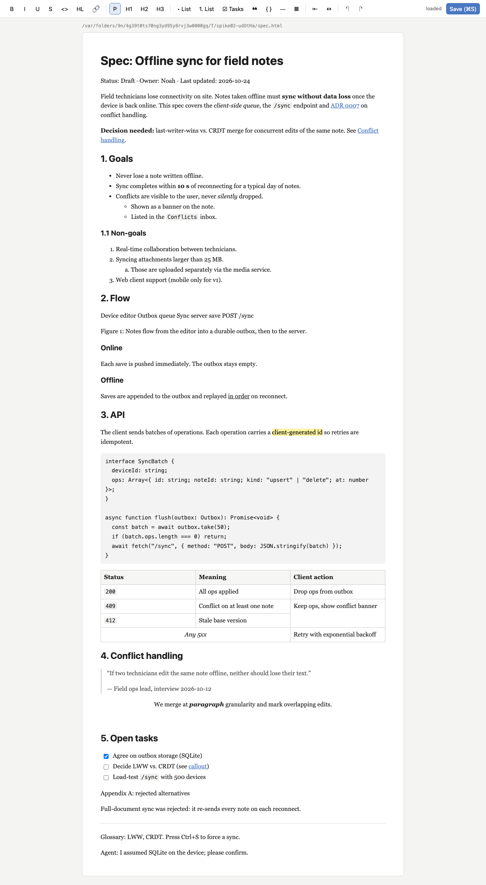

# Spike 02: Tiptap shows a real HTML spec as WYSIWYG — and what does an HTML round trip lose?



## Question

Can a Vue 3 + Tiptap v3 editor (MIT packages only) load a realistic, agent-written HTML spec,
let the user edit it, and save it back as HTML? What exactly does HTML → Tiptap → HTML keep,
change and drop, is the round trip stable, and what does that mean for later spikes (raw HTML
island, `<head>`/styles, readable diffs for the agent)?

## What I built

| file | what it does |
|---|---|
| `../samples/spec.html` | **Shared sample** (for all spikes): realistic spec with `<head>`+`<style>`+comment, h1–h3, marks, links, nested bullet/numbered lists (`type="a"`), task list, table (header row, `rowspan`, `colspan`, inline style), code block with language, blockquote, `div.callout.warning`, inline SVG diagram (boxes, arrows, labels) in `<figure>`, two-column `display:grid` div, ``, `<details open>`, `<hr>`, `<small>/<abbr>/<kbd>`, custom `<x-agent-note>`, classes / ids / `data-*` |
| `../samples/edge-inline.html` | Inline edge cases: nested marks, `b/i/del/ins/sub/sup/font/span style`, mark colours, entities, whitespace runs, link variants incl. `javascript:`, inline comment, attrs on `<p>`, inline svg + base64 img |
| `../samples/edge-structure.html` | Structure edge cases: h4–h6, empty `<p>`, loose body text, `section/article`, multi-paragraph `li`, `ol start/reversed`, nested task list, GitHub-style checkbox, `dl`, table with `caption/colgroup/thead/tfoot`, `pre` w/o `code`, `lang-`/`data-language`, `figure`, `iframe/video/script/form/noscript` |
| `src/extensions.ts` | One extension list shared by the app and the fidelity script: StarterKit (v3 includes Link, Underline, ListKeymap, TrailingNode, UndoRedo), `TableKit`, `TaskList`/`TaskItem` (from `@tiptap/extension-list`), Image, Highlight (multicolor), TextAlign, Typography, Placeholder (from `@tiptap/extensions`). All 34 installed `@tiptap/*` packages are **MIT** (checked `license` fields). |
| `src/App.vue`, `src/editor.css` | Vue 3 app: `useEditor` + `EditorContent`, toolbar (B/I/U/S/code/highlight/link, P/H1–H3, lists, tasks, quote, code block, hr, table, align, undo/redo), Save button + ⌘/Ctrl-S, dirty status. Exposes `window.__editor` for tests. |
| `server/server.ts` | Node/TS server (same shape as spike 01: one process per doc). `GET /doc` → `{path, head, body, mtimeMs}`; `PUT /doc` (editor HTML) → spliced back into the **original shell** (doctype + `<head>` + `<body>` tag kept byte-for-byte) and pretty-printed with prettier. Serves the app through Vite in middleware mode → one process, one port (5102; Vite HMR on 5202). |
| `lib/htmlDoc.ts` | `splitDocument` / `joinDocument` (head/body split) and `formatBody` (prettier). |
| `fidelity/` | `npm run fidelity`: round-trips every `../samples/*.html` through three converters and probes ~60 constructs. Writes `fidelity/report.md` (full report) and raw outputs to `fidelity/out/`. |
| `verify/verify.ts` | `npm run verify`: Playwright end-to-end (20 checks). |

## How to try it

```bash
cd spikes/project-collab/02-tiptap-wysiwyg
npm install
npx playwright install chromium   # once
npm start                         # http://127.0.0.1:5102/ — edits .work/spec.html (fresh copy of ../samples/spec.html)
npm start -- path/to/other.html   # edit any HTML file in place (pretty-printed on save; --no-pretty to disable)
npm run fidelity                  # round-trip report → fidelity/report.md + fidelity/out/*.html
npm run verify                    # headless proof, exits 0/1, refreshes screenshot.png
```

In the UI: scroll through the spec (compare with `../samples/spec.html` opened directly in a browser
to *see* the losses: no callout box, no diagram, no two columns). Type somewhere, select text, click
**B**, press **Save** (or ⌘S), then look at `.work/spec.html`: `<head>` is untouched, the body is
Tiptap's HTML, pretty-printed.

## Findings

### Headline numbers (`npm run fidelity`, real editor in headless Chromium, Tiptap 3.32.0)

| sample | constructs probed | kept | altered | dropped | words of text kept | stable after |
|---|---|---|---|---|---|---|
| spec.html | 49 | 24 | 12 | 13 | 363/363 | 1st pass |
| edge-inline.html | 30 | 9 | 10 | 11 | 102/102 | 1st pass |
| edge-structure.html | 35 | 14 | 10 | 11 | 125/129 (script/noscript text) | 2nd pass |

**Text is never lost** (except `<script>`/`<noscript>`), but **everything that isn't a Tiptap
node/mark loses its element and attributes** — the text gets flattened into `<p>`s.

### Per construct (spec.html; the full tables for all samples are in `fidelity/report.md`)

| construct | result | how |
|---|---|---|
| `<head>`: title, meta, `<style>`, comment | **kept** by design | The editor never sees it: the server splits the file and splices the body back. If you naively `setContent()` the whole file, head is **silently discarded** (no title/CSS text leaks into the body, measured). |
| h1/h2/h3, paragraphs text | kept | identical text; heading **ids dropped** (7×) |
| strong / em / u / code / mark / `&nbsp;` | kept | identical |
| `b`/`i`/`del` (edge) | altered | → `strong`/`em`/`s` |
| `ins`, `sub`/`sup`, `span style=color`, `font`, `small`, `abbr`, `kbd` | dropped | tag gone, text kept (sub/sup/color would need the MIT extensions Subscript/Superscript/TextStyle+Color — not installed) |
| code inside bold/italic (edge) | altered | the `code` mark excludes all other marks → bold/italic removed from the code span |
| links | altered | `href`/`title` kept, but **`target="_blank" rel="noopener noreferrer nofollow"` added to every link, including `#anchor` links**; `javascript:` links removed (text kept) |
| bullet / numbered / nested lists, `ol type="a"`, `ol start` | kept | `li` text gets wrapped: `<li>text</li>` → `<li><p>text</p></li>`; `ol reversed` dropped |
| task list | altered | checked states kept; markup expanded to `<label><input type=checkbox><span></span></label><div><p>…</p></div>`. GitHub-style `<li><input type=checkbox>` → plain bullet (checkbox lost) |
| table, `th` header row, `rowspan`, `colspan`, cell `text-align` | kept | `thead`/`tbody`/`tfoot` flattened into one `tbody`; cell text wrapped in `<p>`; Tiptap **adds** `<colgroup>` + `style="min-width:…"`; original `col` widths and cell `style="background"` dropped |
| `<caption>` (edge) | **altered badly** | caption becomes an extra first table **row** — corrupts the table |
| code block + `language-typescript` | kept | code text byte-identical incl. indentation; `lang-js` / `data-language` not recognised; `<pre>` w/o `<code>` gets `<code>` |
| blockquote, hr | kept | |
| `p style="text-align:center"` | kept | normalised to `style="text-align: center;"` |
| img | altered | `src/alt/width/title` kept; `class`, `data-*`, `height` dropped. Inline `` inside a paragraph and `data:` URIs are **dropped** (Image is block-level and `allowBase64` is off by default) |
| **callout `<div class="callout warning">`** | altered | div, class, id, `data-kind` gone → a plain `<p>` (bold + link inside kept). Visually: no box, no colour |
| **inline `<svg>` diagram** | **dropped** | graphics gone; the 5 `<text>` labels are flattened into one paragraph: "Device editor Outbox queue Sync server save POST /sync" |
| `<figure>/<figcaption>`, `<details>/<summary>`, `<header>`, `<section>/<article>`, `<dl>`, `<x-agent-note>` | dropped | element gone, text kept as `<p>`s; `details` loses open/closed |
| **two-column grid `<div style="display:grid">`** | dropped | layout gone, columns stacked; inner h3/p kept |
| `iframe`, `video`, `form`, `script`, `noscript` (edge) | dropped | completely |
| classes | dropped | 11 → 1 (only the code block's `language-*` survives) |
| ids | dropped | 10 → 0 → in-document `#anchor` links now **dangle** |
| `data-*` (non-Tiptap) | dropped | 7 → 0 |
| inline styles | altered | only `text-align` and highlight colour survive (Chromium normalises `#ffc078` → `rgb(255, 192, 120)`) |
| comments | dropped | `<!-- … -->` in the body disappear (the head comment survives thanks to the split) |
| whitespace inside text | altered | runs of spaces/newlines collapse to one space (renders the same); leading whitespace of loose body text survives pass 1 (`<p> Loose text`) and disappears in pass 2 |
| Typography on load (edge) | kept | `--`, `...`, `(c)`, `"` are **not** converted on load — Typography only acts while typing |
| attributes overall | — | 127 → 30 on spec.html |

### Idempotence

- spec.html and edge-inline.html: **pass1 → pass2 → pass3 byte-identical** (HTML and JSON), in all
  three converters. After the first load, Tiptap's HTML is a fixed point.
- edge-structure.html: needs **two** passes; the only pass-1 → pass-2 change is the leading space of loose
  body text (`<p> Loose text…` → `<p>Loose text…`).
- **prettier → load → save → prettier is a fixed point** for all three samples: the whitespace that
  prettier inserts (`<p>\n  text\n</p>`) is absorbed by the parser, so `getHTML()` of the pretty file equals
  `getHTML()` of the unformatted one (spec, edge-inline).

### Source formatting and diffs

- `getHTML()` is **one line** (only `<pre>` keeps newlines): spec body 119 lines → 10 lines, 4.2 KB.
  Indentation and line breaks of the agent's source are gone.
- A **one-word edit** in a paragraph: raw output diff = 2 changed lines / **3,829 chars** (the whole
  one-line body); pretty output diff = 2 changed lines / **127 chars** (spec.html). For edge-inline:
  2203 chars vs 285 chars.
- The server therefore pretty-prints on save (prettier `parser: 'html'`, `printWidth: 100`). The
  result is readable (`<li><p>…</p></li>` on one line, long paragraphs wrapped) but has prettier's
  quirks (`>ADR&nbsp;0007</a\n>`), and a reflowed paragraph can change several lines.

### Converters: real editor vs. Node (`@tiptap/html` happy-dom vs. jsdom)

- **spec.html: all three produce byte-identical HTML and JSON.**
- **jsdom = Chromium** except for tables: the real editor runs Tiptap's `fixTables` normalisation (it pads
  the broken caption row with an empty cell); `generateJSON`/`generateHTML` in Node doesn't run editor
  plugins, so non-rectangular tables come out differently.
- **happy-dom (`@tiptap/html/server`, the official helper) differs on CSS colours**: it keeps `#ffc078`
  where Chromium and jsdom normalise to `rgb(…)`. The JSON is the same.
- → Server-side conversion (for example, to convert agent edits to JSON for Yjs later) is good enough
  with `@tiptap/html/server`, but only the real editor (or a headless `Editor` instance) is the
  reference. Don't mix Node-normalised and browser-normalised HTML in one diff.

### Other observations

- `npm run verify` caught two real UI gotchas: (1) on macOS, Chromium uses mac key bindings, so `Home`/`End`
  don't move the caret; (2) ProseMirror picks up a click's DOM selection **asynchronously**
  (selectionchange). Typing right after `click()` goes to the old selection, which was the end of the doc in
  this case. Wait for `editor.state.selection` before typing. This also matters for the agent driving
  the UI.
- Placeholder, Typography, TextAlign, Highlight and Underline cost nothing in fidelity terms. The losses come from
  schema gaps, not from these extensions.
- I did **not** test `Link.configure({ HTMLAttributes: { target: null, rel: null } })` to stop the
  `target=_blank` injection. Tiptap documents it, so it's very likely a one-liner.

### verify (20 checks, green)

The page loads and renders h1, 5×h2, h3, the table with 3 `th`, bullet/nested/numbered lists, the task list with 3 checkboxes, and
the code block. There are no console errors. The test types a sentence after "1. Goals", selects it, clicks toolbar **B** (bold in
the editor, status "unsaved changes"), and clicks **Save**. Then the file on disk contains `<strong>Verify sentence typed by
Playwright.</strong>` directly after the Goals `<h2>`, `<head>` is byte-identical, and the file is pretty-printed.
After a reload the sentence is still there. The shared sample is unchanged.

## Verdict / recommendation for the real product

1. **Tiptap is a good fit for the prose part of a spec. On its own it cannot hold an agent-written
   HTML document.** Headings, marks, lists, tables (incl. merged cells), code blocks, quotes and
   task lists survive with all text and a stable fixed point after one pass. Every "designed"
   element (callout, SVG diagram, grid layout, figure, details, custom tags) is flattened on the
   **first load**, before the user changes anything. With plain HTML storage, opening a doc
   **destroys the agent's diagrams**. That is not acceptable, so we need custom nodes.
2. **Custom nodes needed (input for spike 04 "raw HTML island")**, in priority order:
   - **Raw HTML island** (atom block node, stores `outerHTML` verbatim, renders it in a NodeView,
     optionally with editable text): for `<svg>`, `<figure>` + svg, `<div style="display:grid">`,
     `<iframe>/<video>`, unknown custom elements (`<x-agent-note>`), `<form>`. It also works as the catch-all
     fallback for anything not in the schema (`parseHTML` with low priority on any `div[style]`, `svg`, `[class]`…).
   - **Callout** (`div.callout` with a `kind` attr, block content): an editable container node rather than
     an island, because users will want to type in it.
   - **Details/summary** (container node, `open` attr).
   - **Global attribute preservation**: one extension that adds `id`, `class` and `data-*` as
     `addGlobalAttributes` to all block nodes, which fixes dangling `#anchor` links. Possibly `style` too.
   - Small MIT extensions: Subscript, Superscript, TextStyle + Color. Configure Link without target/rel.
     Table caption needs a custom node or an island (today it corrupts the table).
3. **Keep `<head>`/`<style>` out of the editor**: split into shell + body, so the editor only owns the
   body (implemented here, verified byte-for-byte). Later, inject the doc's own `<style>` into the editor
   page scoped to `.tiptap`, so callouts and so on look the same in the editor as in the file. This only
   helps once classes survive (point 2).
4. **Pretty-print on save (prettier)**: the agent gets readable 1–2-line diffs (127 vs 3,829 chars for a
   one-word edit), and the formatted file round-trips to the same document. Keep it.
5. **Accept "normalisation on first open" explicitly**: the first save after opening a doc rewrites much
   of it (`li > p`, colgroup, link attrs, stripped attrs). Either do a normalising save right at
   `collab open` (so later diffs only show real edits) or warn the agent. Combined with islands, the
   remaining normalisation is cosmetic.
6. Server-side HTML→JSON (`@tiptap/html/server`) matches the editor for normal content. Use it in
   the server if Yjs needs JSON (spike 03), but treat the browser editor as the source of truth.

## Open questions

- Can a raw HTML island stay editable (text inside SVG `<text>` / grid columns) without becoming a
  second editor? Nested editors vs. `contenteditable` islands vs. "edit as source" (spike 04).
- Should the stored format stay HTML with islands, or should the canonical format be ProseMirror JSON/Yjs with HTML as
  an export? Fidelity is similar in both cases once islands exist. The question is mostly about agent ergonomics.
- Is the doc's `<style>` safe to inject into the editor page (it targets `body`, `h1`, … and would restyle
  the toolbar)? It probably needs scoping (`@scope` or a shadow root).
- prettier reflows paragraphs, so a one-word edit near a wrap point changes several lines. Is
  `printWidth: Infinity` (one paragraph per line) better for agent diffs?
- Is the 2-pass stability on odd inputs (loose text) a problem for "did the user change anything?"
  detection? We could normalise twice on open.
