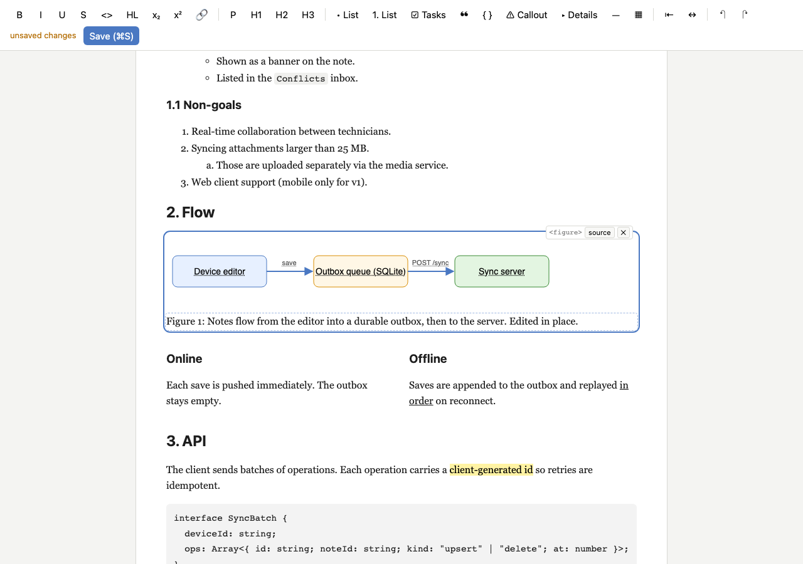

# Spike 04: HTML islands. Keep everything Tiptap can't model and keep prose editable



(`screenshot-full.png` shows the whole document after the verify edits.)

## Question

Spike 02 showed that opening an agent-written spec in Tiptap destroys, on first load, the inline
SVG diagram, the callout, the grid layout, `figure`, `details`, `header`, custom tags, every
id/class/`data-*`, sub/sup/colour and table captions. Can we get to a (near) lossless HTML round trip
and keep the prose editable? Can the user still edit the *text* inside things Tiptap can't model, such as SVG
labels, without a second editor?

## What I built

Started as a copy of spike 02 (server, app, fidelity, verify). New/changed:

| file | what it does |
|---|---|
| `src/islands/classify.ts` | **The one rule**: island vs. node (see "Rules for the real product"). It runs on parse5 trees and on live DOM. |
| `src/islands/source.ts` | `prepareForEditor(body)` uses parse5 with source locations. It replaces every island element and comment by a placeholder `<div data-raw-island="…exact source…">` (`<span>` when inline), and trims loose body text at block boundaries (this fixes spike 02's 2-pass instability). `replaceLeafText(html, path, text)` changes the text of one element in an island's source and leaves **every other byte** alone. |
| `src/islands/raw.ts` | Placeholder encode/decode, `expandIslands()` (it tolerates prettier's line wrapping and quote switching). |
| `src/extensions.ts` | Spike 02's list plus: `htmlIsland` (block atom) and `htmlIslandInline` (inline atom), each with a byte-exact `html` attr and a fallback `*` parse rule. `Callout` (`div.callout`), `Details` + `DetailsSummary`, and a generic `Container` (section/article/header/footer/aside/main/nav/div: tag + attrs kept, `block+` content). `PreserveAttributes` (global `htmlAttrs` on 30 node/mark types). `InlineTag` mark (small/abbr/kbd/ins/cite/q/time/font/plain span…, tag + attrs). Subscript, Superscript, TextStyle+Color+BackgroundColor (all MIT). Link without injected `target`/`rel`. Image inline + base64. Code mark that combines with bold/italic. CodeBlock keeps `<code>` attrs (`lang-js`, `data-language`). |
| `src/IslandView.vue`, `src/islands/render.ts` | Vue NodeView. It renders the island in a **shadow root** with the doc's own `<style>`, has display-only sanitising and in-place text editing, and a toolbar (`<tag>` · source · ✕). |
| `src/App.vue` | Load: `prepareForEditor` → `setContent`. The doc's `<style>` is injected as `@scope (.tiptap) {…}`, so callout and badge look like the file. Toolbar: + sub/sup, callout, details. |
| `server/server.ts` | Port **5104** (HMR 5204). PUT: prettier on the placeholder HTML, **then** `expandIslands`, so island source is never reformatted. |
| `fidelity/` | `npm run fidelity` compares **before** (spike 02 schema, `baselineExtensions.ts`) vs **after** (real editor) with 4 outcomes (kept / normalised / altered / dropped). It also covers island byte-exactness, idempotence, the prettier path, one-word diff size, and 11 "odd agent HTML" cases. Output goes to `fidelity/report.md`. Spike 02's report is kept as `fidelity/report-spike02.md`. |
| `verify/verify.ts` | `npm run verify`: 48 Playwright checks (below). |

## How to try it

```bash
cd spikes/project-collab/04-html-islands
npm install
npx playwright install chromium   # once
npm start                         # http://127.0.0.1:5104/ edits .work/spec.html (fresh copy of ../samples/spec.html)
npm start -- path/to/other.html   # any HTML file, in place
npm run fidelity                  # before/after report → fidelity/report.md
npm run verify                    # headless proof, exits 0/1, refreshes screenshot*.png
```

In the UI:
- **2. Flow**: the SVG diagram renders as SVG. Hover a label (dotted underline) and click it: an in-place text box opens with the caret at the clicked character. Type, then Enter/Esc. The figure caption is directly editable.
- Hover the figure to get the island toolbar. **source** opens the raw HTML in a textarea (Apply re-renders). **✕** deletes the island.
- The callout (yellow), the two-column grid, the header and the "Appendix A" details are normal editable nodes. The `▾ open` button left of the details toggles whether it is `open` in the file.
- The agent note at the bottom is an island (custom element): click and type.
- ⌘Z inside an island undoes through the editor's history. Save, then look at `.work/spec.html`: the `<svg>` is byte-identical except your label, and all ids/classes/`data-*` are still there.

## Findings

### Fidelity before → after (`npm run fidelity`, real editor in headless Chromium, Tiptap 3.32.0)

| sample | constructs | before: kept / normalised / altered / dropped | **after** | words kept | attributes kept | islands byte-identical (raw / after prettier) | stable after pass |
|---|---|---|---|---|---|---|---|
| spec.html | 50 | 23 / 8 / 5 / 14 | **39 / 11 / 0 / 0** | 363/363 | 30 → 131 (of 127) | 2/2 / 2/2 | 1st → 1st |
| edge-inline.html | 32 | 10 / 6 / 4 / 12 | **25 / 7 / 0 / 0** | 102/102 | 11 → 29 (of 30) | 2/2 / 2/2 | 1st → 1st |
| edge-structure.html | 41 | 14 / 6 / 4 / 17 | **32 / 9 / 0 / 0** | 125 → 129/129 | 15 → 33 (of 30) | 10/10 / 10/10 | **2nd → 1st** |

**Goal met: every probed construct is "kept" or "normalised".** Nothing is altered or dropped.
Per construct (worst result across the samples, full table in `fidelity/report.md`):

| construct | before | after | how |
|---|---|---|---|
| inline `<svg>` diagram, `<figure>`, `<x-agent-note>`, `<iframe>/<video>`, `<form>`, `<dl>`, body `<script>/<noscript>` | dropped | **kept** | raw HTML island, **byte-identical source** (also after prettier) |
| table with `<caption>` (+ colgroup widths, tfoot) | altered (caption became a row) | **kept** | whole table becomes an island (cell text still editable in place) |
| HTML comments in body | dropped | **kept** | comment island (shown as a chip) |
| callout `div.callout.warning#decision-needed[data-kind]` | altered | **normalised** | editable node, all attrs kept; its loose inline content gets wrapped in `<p>` |
| grid `<div style="display:grid" class="two-col">` | dropped | **kept** | generic container: style + class kept, so the grid **renders and stays editable** |
| `details[open] > summary`, `header/section/article` | dropped | **kept** | editable nodes, `open` and tag kept |
| ids / classes / `data-*` / `title,dir,lang` / `blockquote cite` / `th scope` / `ol reversed` | dropped | **kept** | `PreserveAttributes`: 10/10 ids, 11/11 classes, 7/7 `data-*`, so `#anchor` links work |
| link `target`/`rel` | altered (added `_blank` everywhere) | **kept** | `Link.configure({ HTMLAttributes: { target: null, rel: null } })`: one line, as predicted |
| `small`, `abbr[title]`, `kbd`, `ins`, `font`, plain/classed `span` | dropped | **kept** | `InlineTag` mark (tag + attrs, nestable) |
| sub/sup | dropped | **kept** | MIT Subscript/Superscript |
| text colour / background (`span style`) | dropped | **normalised** | TextStyle + Color. Chromium writes `#c00` as `rgb(204, 0, 0)` |
| code inside bold/italic | altered | **kept** | `Code.extend({ excludes: '' })`, registered last |
| `<code class="lang-js">`, `data-language` | altered | **kept** | CodeBlock keeps `<code>` attrs |
| img (class, `data-*`, height, base64, inline) | altered / dropped | **normalised** | all attrs kept; a top-level `` gets wrapped in `<p>` (Image is inline now) |
| GitHub-style `<li><input type=checkbox>` | dropped | **normalised** | checkbox becomes an inline island inside `<li><p>` |
| `javascript:` link, `on*` attributes | – | **normalised (by policy)** | removed, text kept (see sanitising rules) |
| remaining harmless normalisations | | normalised | `<b>/<i>/<del>` → `strong/em/s`; `<li>`/`<td>` text → `<p>`; thead/tfoot flattened; Tiptap's own `<colgroup>`/min-width; whitespace runs collapse; `style` re-serialised (`display:grid` → `display: grid;`); attribute order may change |

Two stats explain where the remaining diffs are. **Attributes:** 127 in → 131 out, because Tiptap adds colgroup/min-width. The 1 missing attribute in edge-inline is the removed `javascript:` href. **Words:** spike 02's "lost" script/noscript words are back.

### Idempotence and the save path

- **Stable after the first pass on all three samples** (spike 02: edge-structure needed 2 passes).
  The leading-space instability of loose body text is fixed in `prepareForEditor`. Islands are fixed
  points by construction: the attribute *is* the source.
- The editor JSON still changes between pass 1 and pass 2 on two samples, while the HTML does not. The cause is the stored
  `style` string (`display:grid;…` in the first JSON, the browser-normalised `display: grid;` afterwards).
  This is harmless, but "did the user change anything?" must compare HTML, not JSON.
- **prettier path**: format→load→save→format is a fixed point. A one-word edit diff is 144 chars (pretty) vs 3,166 (raw).
  The island source survives prettier because the server formats the *placeholder* HTML and expands afterwards.
  **Gotcha found**: prettier changes `data-raw-island="…&quot;…"` into a single-quoted attribute with decoded `"`
  when that needs fewer escapes. The first version of `expandIslands` missed it and left placeholders in the file. verify caught it.
- Node converters: jsdom matches the browser except for attribute order on the grid div. happy-dom keeps `#c00`
  where Chromium writes `rgb()`, as in spike 02. Islands are identical in all three.

### Island text editing: how it works, how robust it is

Approach **(a), in place**, with two mechanisms:

1. **HTML text leaves** (an element whose children are only text: `p`, `span`, `figcaption`, `td`, `x-agent-note`, …) get
   `contenteditable="plaintext-only"` inside the shadow root. This gives native caret, selection, IME, spellcheck-free typing, and paste-as-text.
2. **SVG `<text>`/`<tspan>`**: measured, **`contenteditable` on SVG elements does nothing in Chromium**. Making an
   HTML *ancestor* editable does make SVG text editable, but the whole SVG becomes editable, and deleting the last
   character inserts `<br>` into `<text>` (structure corruption). So a mousedown on an SVG label opens a small HTML
   `plaintext-only` overlay over the label. It uses the same font family and size (scaled by `getScreenCTM`), and the caret lands at the clicked character
   (`getCharNumAtPosition` + `getExtentOfChar`). The label underneath updates live and the overlay stays centred.

Every `input` (not during IME composition; on `compositionend`) runs
`replaceLeafText(attrs.html, path, text)` → `updateAttributes({ html })`. That is one ProseMirror transaction, so it has
undo/redo now and is ready for Yjs later. The path is the element-child index path. It is identical in the rendered shadow DOM
and in the parse5 tree of the source, because display sanitising only rewrites attributes and never adds or removes elements.
The NodeView doesn't re-render for its own update (`lastLocal`), so the caret survives. It re-renders for undo, source edits and remote changes.

Robustness, as proven by `npm run verify` (48 checks, all green):
- SVG label: click → overlay → type → live SVG update + node attr updated → Enter closes. Saved file: **`<svg>` byte-identical except the label**,
  and the whole `<figure>` byte-identical except label and caption.
- `figcaption` edited natively. Island typing **never leaks into ProseMirror** (doc text unchanged except the callout edit).
- Select-all inside a leaf selects only that leaf. **IME** (CDP `imeSetComposition` + `insertText`): no commit mid-composition, correct commit after.
- ⌘Z inside the island is routed to ProseMirror history and the island re-renders. Toolbar undo restores the label, and a save after undo gives a
  **byte-identical** SVG again.
- An emptied element stays clickable and editable after a re-render. A first run failed here because an empty custom element collapsed to 0×0 and verify caught it.
  Fixed with `:empty { min-width }`.
- Enter never inserts a newline or `<br>`. ⌘B/I/U are swallowed. "source" → textarea → Apply re-renders. In a mixed-content
  element (`<x><b>A</b> text</x>`) only the text-only children are editable.
- ids all survive the save (10/10). The callout keeps all attrs after editing its text. No console errors anywhere.

Pitfalls found or still open:
- **Events from a shadow root are retargeted to the host.** Tiptap's default `stopEvent` checks `event.target.isContentEditable`
  and misses them, so ProseMirror would grab the mousedown (NodeSelection) and steal focus. The fix is a custom `stopEvent` that
  checks `event.composedPath()` for `[data-leaf-path]` / `[data-island-ui]`. Selection is not stolen because
  `view.hasFocus()` is false while focus is inside the shadow root. **Mutations inside the shadow root are not observed**
  by ProseMirror's MutationObserver, so `ignoreMutation` is not needed for the island content. That is a big plus of shadow DOM.
- The browser's own contenteditable undo stack would fight ProseMirror's, so ⌘Z/⇧⌘Z/⌘Y are intercepted. Undo granularity follows
  ProseMirror's `newGroupDelay` (500 ms). Measured: a label edit and a caption edit in the same island within that window form **one** undo step.
- Arrow keys don't leave an island leaf (you stay at the text edge). You leave with Enter/Esc (which selects the island node) or a click.
- Text directly inside a mixed-content element (`<p>Saves are <u>in order</u> on…</p>` in an island) is **not** editable. Only
  text-only leaves are. Use "source" for that, or make such content a container instead of an island.
- SVG overlay: wrapped/multi-line `<text>` (several `tspan`s with x/dy) edits per tspan. Text on a path (`textPath`)
  and rotated labels get an unrotated overlay. An emptied SVG label has no box and can't be clicked again (source only).
- Clipboard: copying an island copies the placeholder (`<div data-raw-island>`). Pasting it back into the editor works,
  but pasting into another app gives the placeholder, not the SVG. The clipboard serializer needs an expand step.
- Approach (b) (popover "edit text") would avoid the overlay positioning problems and handle mixed content more easily,
  but it loses the WYSIWYG feel. (a) worked well enough here that (b) wasn't needed. (b) is the fallback for rotated or path text.

### Container vs. island in practice

- The **grid stays a container**, not an island. With its `style` kept it renders as two columns *and* both columns
  are fully editable (marks, lists, Enter…). That is better than an island with leaf-only editing. The open risk is that a user can merge or
  split the column divs with Backspace/Enter at the edges (normal ProseMirror behaviour for a `block+` container).
- **Callout** as a dedicated node gives a toolbar command (`wrapIn('callout')`). A generic container would round-trip it just as well.
- **Doc CSS in the editor**: `@scope (.tiptap) { …doc <style>… }` with `:root` → `:scope` works in Chromium. The callout gets the
  doc's warning colours, and the status badge and muted text look like the file. Inside islands the CSS is injected raw into each shadow root (`:root` → `:host`).

### Odd agent HTML (`fidelity/report.md`, "HTML the schema cannot hold")

All 11 cases are stable after pass 1. What happens:
- Stray inline markup at top level (`<b>Bold</b> loose <i>…</i><p>…`) gets wrapped into one `<p>`. Fine.
- Unclosed tags (`<p>one<p>two<ul><li>a<li>b</ul>tail`) are repaired by the HTML parser, then turned into normal nodes. Fine.
- `<span class="note"><p>A</p><p>B</p></span>` duplicates the span **into each paragraph** (inline mark over blocks).
- `<a href><div>…</div></a>` becomes `<div><p><a>…</a></p></div>`: the link moves inside.
- Text directly in `<ul>` becomes its own `<li>`. Text directly in `<table>` gets hoisted *before* the table (as the HTML parser does).
- An unknown element with prose inside (`<x-card><h2>…<p>…</x-card>`) becomes a block island: byte-exact, but the prose is
  only leaf-editable. If agents use custom wrappers a lot, they should be listed as containers.
- A comment **between `<li>`s / table rows** is dropped. Placeholders can't live there, so prepare leaves it and ProseMirror drops it.
- A doc ending in an island/container gets a trailing `<p></p>` from StarterKit's TrailingNode. It is stable after the first time.
- `` → `onerror` removed. `javascript:` link → link removed, text kept.

## Verdict / recommendation for the real product

**Yes: with islands + attribute preservation, HTML round trips are effectively lossless for agent-written specs.**
On the three samples nothing is altered or dropped, every island is byte-identical, and the doc is a fixed point after
one pass. Keep HTML as the storage format: it is now as faithful as JSON would be, and the agent keeps editing plain HTML.

### Rules for the real product

1. **Island vs. node: decide by schema coverage, not by looks.**
   - An element becomes a **raw HTML island** iff its tag is not modelled by the schema (`KNOWN_TAGS` in `classify.ts`):
     `svg`, `math`, `canvas`, `figure`, `iframe`, `video`, `audio`, `form`/controls, `dl`, `script`, `style`, `noscript`,
     `template`, **any custom element / unknown tag**, plus known tags in shapes the schema can't hold (`table` with `<caption>`).
     Islands are **inline** when their parent holds phrasing content (`p`, `h*`, marks) or, in `li`/`td`, sit next to text. In containers they are **block**.
   - Everything else is a **real node** and stays fully editable. Wrappers that contain prose (`div`, `section`, `article`, `header`,
     `footer`, `aside`, `nav`, `main`) are generic **containers** (tag + all attributes kept, `block+` content). Specific
     containers get their own node when they need UI: callout (`div.callout`), `details/summary`.
   - Rule of thumb for adding to the schema: if users will *type paragraphs* in it, make it a container. If its value is its
     *structure* (graphics, embeds, layout primitives with meaning in attributes), it stays an island with leaf-text editing.
   - Islands are captured **at source level** (parse5 source locations) so they are byte-exact. The live-DOM parse rule is only a
     fallback (paste, programmatic `setContent`) and keeps DOM-normalised `outerHTML`.
2. **Attribute policy**: every node and mark keeps all attributes it doesn't model itself (`id`, `class`, `data-*`, `style`, `title`,
   `lang`, `dir`, `cite`, `scope`, …) in one `htmlAttrs` attribute (`keepOnSplit: false`, so Enter never duplicates an id).
   CSS properties a node renders itself (`text-align`, table `min-width`) are stripped from the stored style to keep it idempotent.
   Never store `on*`. Copy/paste can still duplicate ids, so a real product needs an id de-dup on paste.
3. **Sanitising**:
   - *Storage*: keep islands verbatim, including `<script>`. The file belongs to the user and agent, and dropping content is data loss.
     Node attributes: drop `on*`, drop `javascript:` links (Tiptap's Link already does).
   - *Display*: islands render in a **shadow root**. This isolates styles both ways and keeps ProseMirror's observer out. Display-only
     sanitising rewrites attributes but never changes structure: remove `on*`, remove `javascript:`/`vbscript:`/`data:text/html` URLs,
     `iframe sandbox=""`, no autoplay, disable form controls, neutralise `meta/base/link`, and prevent link navigation. `<script>/<style>/<noscript>`
     islands show as a chip ("not executed in the editor"). innerHTML-inserted scripts never run anyway. **Not done here, needed for
     untrusted docs**: a real sanitiser (DOMPurify in "keep structure" mode) and/or rendering islands in a sandboxed iframe
     instead of a shadow root. The shadow root isolates CSS but not JS.
   - Comments: keep them as islands where a block or inline node can sit. Comments between list items or table rows are dropped (accepted).
4. **Save path**: `getHTML()` → (server) prettier on placeholders → `expandIslands` → splice into the original shell. Never let a
   DOM serializer or prettier touch island source. Make `expandIslands` tolerant of prettier's quoting.
5. **Island editing** = text-only leaves, edited in place, each keystroke a `setNodeMarkup` on the island's `html` attr via
   `replaceLeafText` (source-level splice). Route undo to ProseMirror. Use a custom `stopEvent` based on `composedPath()`.
   For structure: "edit source" popover. This keeps islands collaboration-friendly: an island is one attribute, so Yjs would
   sync it as a whole string (last-writer-wins per island, which spike 03 should check).

## Open questions

- Yjs: an island is one string attribute, so concurrent edits of two labels in the same island conflict (LWW per island).
  Is that acceptable, or should islands store a `Y.Text` per leaf?
- Clipboard: add a `clipboardSerializer` / `transformCopied` that expands placeholders, so copying a diagram into
  another app works.
- Should agents get a convention ("wrap prose in `<section>`, use `<x-*>` only for non-prose") so the island/container split is
  predictable for them? Or a `data-editable="container"` override attribute on any element?
- Sandboxed iframe vs. shadow root for islands when docs aren't trusted. iframe = real JS isolation but harder text editing
  (cross-document selection, focus) and sizing.
- Arrow-key navigation into and out of island leaves, and a visible "editable text" affordance on touch devices.
- `<summary>` inside the editor is a plain block (the editor always shows details expanded, `open` is a toggle). Is that
  intuitive enough?
