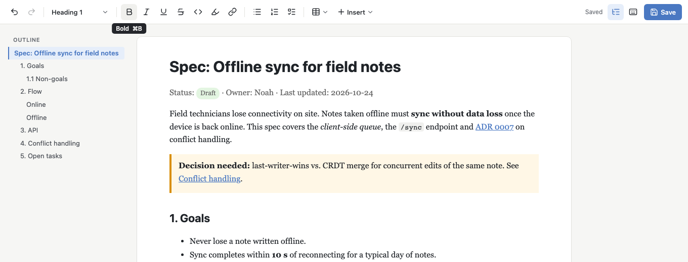
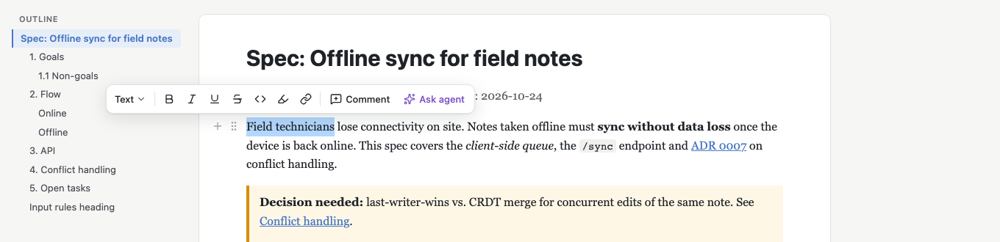
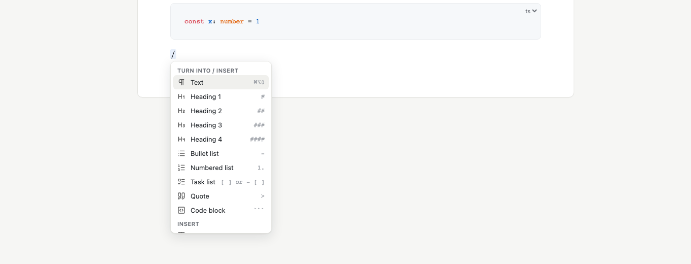
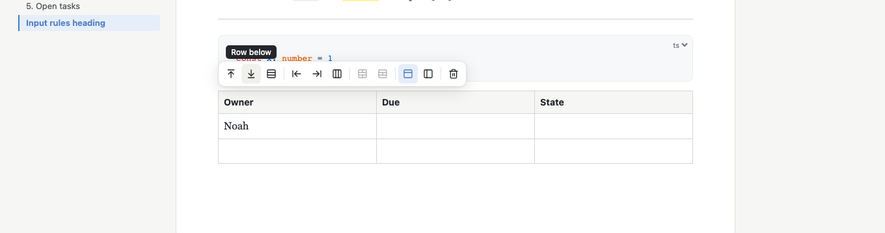
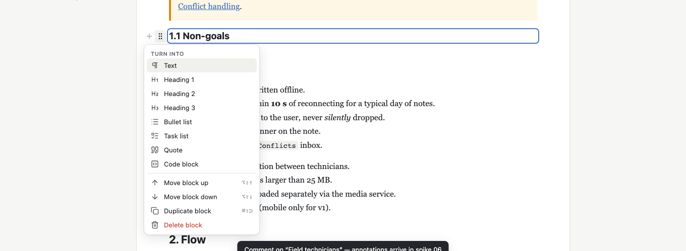

# Spike 05: The editor UI/UX a spec co-editing tool needs



| bubble menu on a selection | slash menu |
|---|---|
|  |  |
| **table menu** (above the table) | **block handle menu** (grip click) |
|  |  |

`screenshot-help.png` shows the `⌘/` shortcut sheet. All screenshots come from `npm run verify`.

## Question

Which Tiptap UI/UX features does a spec co-editing tool need, and how far do the **free/MIT** packages get us?
Can we build a coherent editor (toolbar, bubble menu, slash commands, tables, drag handle, links, code, outline,
keyboard-only use) on top of spike 04's islands without breaking the lossless HTML save path? Which useful
features are Tiptap Pro/Cloud only, and what is the free alternative?

## What I built

This started as a copy of spike 04 (islands, attribute preservation, the prettier→expand save path, fidelity script). Server port **5105** (HMR 5205).

| file | what it does |
|---|---|
| `src/editor/commands.ts` | **One command registry** (label, icon, shortcut, markdown rule, keywords, `run`, `isActive`). The toolbar, bubble, slash menu, block menu and help sheet all render from it, so labels and shortcuts stay consistent. It also holds move/duplicate/delete block (keyboard alternative to dragging; a duplicate drops `id`s so anchors stay unique). |
| `src/editor/uiExtensions.ts` | `SlashCommand` (MIT `@tiptap/suggestion`, popup positioned by the suggestion's own floating-ui `mount()`), `UiShortcuts` (⌘K, ⌘/, ⌥⇧↑/↓, ⌘⇧D), `BulletToTask` input rule (see findings). |
| `src/ui/Toolbar.vue` | Fixed toolbar: undo/redo · block-type dropdown · marks · link · lists · table size picker · Insert menu · outline toggle · help · save state. Tooltips show label and shortcut, buttons show an active state, ARIA toolbar with roving focus. |
| `src/ui/TextBubble.vue` | `BubbleMenu` (`@tiptap/vue-3/menus`) on a text selection: Turn into… · B I U S code highlight link · **Comment** and **Ask agent** placeholders (they show a toast). |
| `src/ui/TableBubble.vue` | Second `BubbleMenu`, anchored **above the table** through `getReferencedVirtualElement`: rows/columns add/delete, merge/split (disabled when not possible), header row/column toggles (active state), delete table. |
| `src/ui/LinkPopover.vue` | Own floating-ui popover. View mode (caret in a link): URL · open · edit · remove. Edit mode (⌘K): URL field, Enter/Esc. `#anchor` links jump to the heading inside the editor. |
| `src/ui/BlockHandle.vue` | MIT `@tiptap/extension-drag-handle-vue-3`: **+** inserts a paragraph below and opens the slash menu; the **grip** drags, and a click on it opens a block menu (turn into, move up/down, duplicate, delete). |
| `src/ui/Outline.vue` | Outline built from headings. A click moves the caret there and scrolls smoothly; the current section is highlighted while scrolling. |
| `src/editor/CodeBlockView.vue` | `CodeBlockLowlight` (lowlight `common` languages) + a language picker NodeView. |
| `src/ui/HelpDialog.vue`, `PromptDialog.vue`, `Dropdown.vue`, `TablePicker.vue`, `SlashMenu.vue`, `store.ts` | Shortcut sheet (generated from the registry), styled prompt (image URL, island HTML), keyboard-navigable dropdown, 8×8 size picker, slash popup, tiny reactive UI store. |
| `src/App.vue` | Layout (sticky toolbar, outline sidebar, page, status bar with word/character count and selection count), load/save, global keys (⌘S, ⌥F10, `?`). |
| `src/extensions.ts` | Spike 04's schema plus: CodeBlockLowlight, `CharacterCount`, a context-aware `Placeholder`, resizable tables, a dropcursor colour, and `Typography` with `emDash: false`. |
| `src/IslandView.vue` | Spike 04 plus one race fix (see findings). |
| `verify/verify.ts` | **76 Playwright checks** of the UI, driven with real mouse and keyboard input. |
| `verify/islands.ts` | Spike 04's 48 island checks, kept as a regression suite. `npm run verify` runs both. |

All new dependencies are MIT, except `highlight.js` (BSD-3, theme CSS only) and `lucide-vue-next` (ISC, icons). I checked each `package.json` in `node_modules`.

## How to try it

```bash
cd spikes/project-collab/05-editor-ui
npm install
npx playwright install chromium   # once
npm start                         # http://127.0.0.1:5105/ edits .work/spec.html (fresh copy of ../samples/spec.html)
npm start -- path/to/other.html   # any HTML file, in place
npm run verify                    # 76 UI checks + 48 island checks, exits 0/1, refreshes screenshot-*.png
npm run fidelity                  # spike 04's round-trip report (unchanged output, see findings)
```

In the UI:
- Type `/` on an empty line: filter with `tab`, `call`, `svg`, `img`… and pick with ↑↓ Enter. Inside a table, `/` also lists the table operations.
- Markdown while typing: `## `, `- `, `1. `, `- [ ] `, `[x] `, `> `, ` ```ts `, `---`, `**b**`, `` `c` ``, `==hl==`.
- Select text to get the bubble menu (Comment / Ask agent are placeholders). ⌘K edits the link. Put the caret in a link to get open/edit/remove.
- Click into a table to get the table menu above it. Shift-click two cells, then merge. Drag a column border to resize.
- Hover a block: **+** adds a block below, and the **⋮⋮** grip drags (drop on the left half of the target line). Clicking the grip opens the block menu. ⌥⇧↑/↓ moves the block from the keyboard.
- The outline on the left jumps to sections. The status bar shows words and characters (and "n of m words" for a selection).
- Without the mouse: ⌥F10 focuses the toolbar (or the open bubble or table menu), ←/→ moves, Enter/↓ opens a dropdown, Esc goes back to the text. ⌘/ (or `?` outside the text) shows all shortcuts. ⌘S saves.

## Findings

### Free vs. Pro: what we can use

As of Tiptap 3.32 (Oct 2026) these were **Pro in v2 and are MIT now**: drag handle (+ Vue component), table of contents, details,
unique-id, file handler, emoji, mathematics, node-range, invisible characters. `@tiptap/suggestion`, bubble/floating
menus, `CharacterCount`, `Placeholder`, lowlight code blocks, tables and the `Collaboration` extension are MIT as well.
**Paid** (tiptap.dev/pricing, Start plan and up): Comments, document history/snapshots, compare versions, the inline AI /
AI Toolkit (agent editing, diff), Tracked Changes (add-on), DOCX/PDF import/export, Pages layout, Tiptap Cloud collaboration and
the "UI Components" (which are React-only anyway). Free alternatives for our product: comments = our own mark plus a sidebar
(spike 06); history and compare = git, plus the Yjs sidecar snapshot from spike 03; agent edits and tracked changes = our own diff
decorations (spikes 07/08); collaboration = MIT `Collaboration` plus self-hosted Hocuspocus; export = the file *is* HTML.

### UX inventory

| feature | extension / package | license | built here | priority for the product |
|---|---|---|---|---|
| Fixed toolbar (grouped, active states, shortcut tooltips) | own Vue + command registry | – | ✅ | must |
| Block-type dropdown ("turn into") | own (`setHeading`/`toggle*List`…) | – | ✅ toolbar, bubble, block menu | must |
| Bubble menu on selection | `@tiptap/vue-3/menus` BubbleMenu (`@tiptap/extension-bubble-menu`, floating-ui) | MIT | ✅ | must |
| Comment / Ask agent on selection | placeholder buttons | – | ⚪ placeholder | must (spike 06 / 08) |
| Slash command menu | `@tiptap/suggestion` + own Vue popup | MIT | ✅ (18 commands, +9 table ops inside a table) | must |
| Markdown input rules | StarterKit, Highlight, TaskItem + own `BulletToTask` | MIT | ✅ verified | must |
| Link popover (open/edit/remove, `#anchor` jump) | Link + own floating-ui popover | MIT | ✅ | must |
| Tables: size picker, rows/cols, merge/split, header toggles | `@tiptap/extension-table` (TableKit) | MIT | ✅ | must |
| Table column resize | TableKit `resizable: true` | MIT | ✅ (writes `colwidth`) | should |
| Block drag handle + block menu | `@tiptap/extension-drag-handle-vue-3` | MIT (Pro in v2) | ✅ | should |
| Move block from the keyboard | own command (⌥⇧↑/↓) | – | ✅ | should |
| Code block syntax highlighting + language picker | `@tiptap/extension-code-block-lowlight` + `lowlight` (+ highlight.js CSS) | MIT (BSD-3) | ✅ | should |
| Outline / TOC sidebar | own (not `@tiptap/extension-table-of-contents`, see below) | – | ✅ | must (it is the sidebar of spike 09) |
| Word / character count | `CharacterCount` (`@tiptap/extensions`) | MIT | ✅ | later (nice) |
| Placeholder | `Placeholder` (`@tiptap/extensions`) | MIT | ✅ context-aware | should |
| Keyboard help sheet | own, from the registry | – | ✅ | should |
| Callout / details / raw HTML island insert | spike 04 nodes + slash/Insert | – | ✅ | must |
| Image by URL | `@tiptap/extension-image` + dialog | MIT | ✅ | should; upload/paste → `@tiptap/extension-file-handler` (MIT) later |
| Find & replace | none official (community or own plugin) | – | ❌ | should |
| Text colour / highlight colours UI | `Color`, `Highlight` multicolor (in the schema) | MIT | ❌ no UI | later |
| Emoji, math, mentions (`@agent`, `@file`) | `extension-emoji`, `-mathematics`, `-mention` | MIT | ❌ | later (mention of files/agents is interesting) |
| Comments, version history, AI, tracked changes | Tiptap Pro / Cloud | paid | ❌ by decision | own implementations (06–08) |

### What matters specifically for agent + user co-editing (ideas, not built)

- **Show what the agent changed recently**: a gutter bar or tinted background on blocks the agent touched in its last write, fading
  over time, plus an "N agent changes" chip in the status bar that steps through them. This sits next to the drag handle and uses the same
  per-block hover position. → spike 07/08 (diff of the agent's file write against the live doc, applied as decorations).
- **Accept/reject per block** for agent proposals, instead of silent overwrite. Our replacement for Pro "Tracked changes".
- **Ask agent / Comment on a selection** (buttons are here): they need a stable anchor (a range mark plus a sidebar thread) that survives the
  agent rewriting the file. → spike 06.
- **Outline as the navigation backbone**: badges per section (open comments, agent edits, open tasks), and "ask the agent about this
  section" from the outline. The outline is also where the brainstorming journal tab of spike 09 lives.
- **Block menu → "Send block to agent" / "Regenerate"**: the block menu is the natural place for per-block agent actions.
- **Presence**: the agent's cursor or "agent is editing section 3" (Yjs awareness, spike 07). The block handle area can show it.
- Read-only lock of blocks while the agent rewrites them would avoid conflicts at the UI level.

### Measured behaviour and problems found (and fixed) along the way

- `npm run verify`: **76/76 UI checks + 48/48 island checks green**, run 3× in a row without flakes after the fixes below.
  `npm run fidelity` output is **byte-identical to spike 04's report**. The new UI extensions (lowlight, resizable tables, CharacterCount,
  Placeholder, suggestion) do not change the HTML round trip. Highlighting is decorations only: no `hljs` reaches the file (checked).
- **`@tiptap/extension-table-of-contents` writes `data-toc-id` into every heading** (a global attribute that is rendered). With our
  attribute preservation that ends up in the saved file for good. So the outline is my own (~60 lines). This shows a general rule:
  **every extension must be checked for attributes it renders into the HTML**. verify asserts that no `data-toc-id`/placeholder/suggestion attribute leaks.
- **Typography's em dash rule turns `--port` into `—port`** and breaks the `---` divider input rule (the first two dashes become `—`). For
  specs full of CLI flags I disabled it (`emDash: false`). verify types `--port 5105` and checks it.
- **`- [ ] ` nested a task list inside a bullet item.** StarterKit turns `- ` into a bullet list first, and TaskItem's `[ ] ` rule then wraps
  the paragraph *inside* the list item. The fix is a priority-1000 input rule that converts the bullet item into a task item (`toggleTaskList`).
  Caveat: it converts the whole bullet list. That is right for a fresh list but debatable for a long one.
- **Island race (a spike 04 bug that the busier spike 05 page exposed)**: Tiptap's `focus()` command defers `view.focus()` to the next animation
  frame. After Enter in an SVG label, a quick click into the figcaption was overtaken by that late focus. ProseMirror then had the
  island NodeSelected, and the next keystroke **replaced the whole diagram**. The fix in `IslandView.focusAfter` is a synchronous
  `setNodeSelection` + `view.focus()`. Rule for the product: never use the deferred `focus()` from inside NodeViews that host their own editable DOM.
- **Debounced outline = stale positions.** Clicking the outline right after an edit jumped to the wrong heading. Rebuilding the list on every
  update is cheap (spec-sized doc ≪ 1 ms), so there is no debounce now.
- **Drag & drop placement** follows ProseMirror's `dropPoint`: before or after the target block depends on the *horizontal text offset* within
  it, not on the vertical half. Dropping on the right half of a short heading puts the block after it. The dropcursor shows the
  target correctly, but users will expect "upper half = before". Worth a custom `dropPoint`/handleDrop later.
  Only top-level blocks are draggable now. The `nested` option exists for list items but I didn't evaluate it (requirements are often list items, so test it).
- Tiptap v3's `BubbleMenu` re-evaluates `shouldShow` only on selection or doc changes and hides on editor blur, unless focus moves into the
  menu. External UI state (link edit mode) therefore lives in its own floating-ui popover instead of a bubble. Two bubbles (text and table) work
  side by side through distinct `pluginKey`s and mutually exclusive `shouldShow`s.
- The table menu as a bubble at the caret covered the cells being edited. Anchoring it above the table via `getReferencedVirtualElement`
  is much better (verify checks that it doesn't overlap). The cost: on long tables it can be far from the caret.
- Column resize writes `colwidth` per cell. After merging cells you get `colwidth="324,0"` (0 = never sized). That is harmless but noisy in diffs.
- `scrollMargin`/`scrollThreshold` + 40vh bottom padding ("scroll past end") were needed: without them the caret line sat behind the
  fixed status bar and the slash menu flipped upwards.
- ProseMirror updates its selection on the async `selectionchange`, so tests (and agent-driven UI automation) must wait ~1 frame after a click
  before relying on `editor.state.selection`.
- Vite's middleware-mode server opens an HMR websocket on the default port 24678 even with `hmr: false`. With two dev servers on one machine,
  the second page logs websocket errors. verify filters exactly that noise, everything else counts as an error.

## Verdict / recommendation for the real product

**The MIT stack covers everything a spec editor needs on the editing side.** Toolbar, bubble menus, slash commands, tables with merge and resize,
drag handle, link editing, highlighted code, outline, counts, input rules and full keyboard access were built in one spike, with a
coherent look, and with no change to the lossless HTML round trip. Nothing we needed was Pro. The paid features (comments, history,
AI, tracked changes) are exactly the agent-collaboration features we want to design ourselves anyway.

Recommendations:
1. Keep **one command registry** as the single source for every menu, shortcut and help entry. Agent actions ("Ask agent", "Send block") plug in there too.
2. Must-haves for v1: toolbar + block-type, bubble (with Comment/Ask agent), slash menu, input rules, tables (menu above the table), link popover,
   outline, callout/details/island insert, keyboard access, ⌘S plus a visible save state. Should-haves: drag handle, column resize, code highlighting, help sheet.
3. **Audit every extension for rendered attributes** before adding it (`data-toc-id` lesson), and keep the fidelity script plus the "no UI
   attributes leaked" check in CI.
4. Spec-friendly defaults: no em dash replacement, context-aware placeholders, anchor links that jump inside the doc, and duplicate-without-id.
5. Build the agent-awareness UI (recent agent changes, accept/reject, presence) on the same block-level hooks (drag handle position, block menu, outline badges).

## Open questions

- Drop position: implement "upper/lower half" semantics, and enable `nested` drag for list items?
- Should `- [ ] ` in an existing multi-item bullet list convert only that item (split the list) rather than the whole list?
- Find & replace: no official MIT extension. Write our own (decorations + search state) or use a community package?
- Table menu on very long tables: stick to the viewport top while the caret is in the table?
- Mobile/touch: the bubble and drag handle are desktop patterns. Do we care for v1?
- How should "Ask agent" talk to the session (spike 01's channel), and does the answer come back as a proposal (accept/reject) or as a comment?
