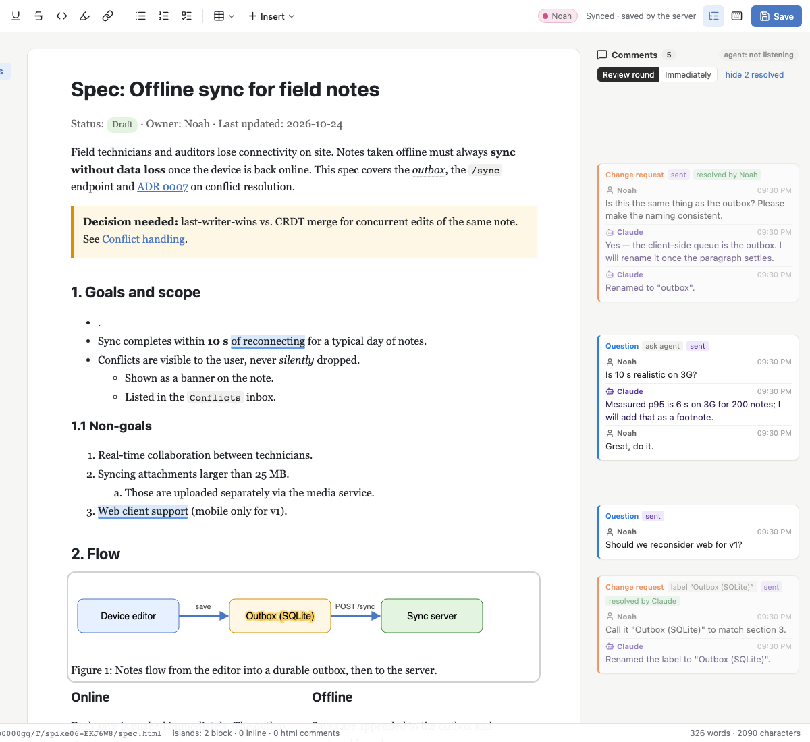
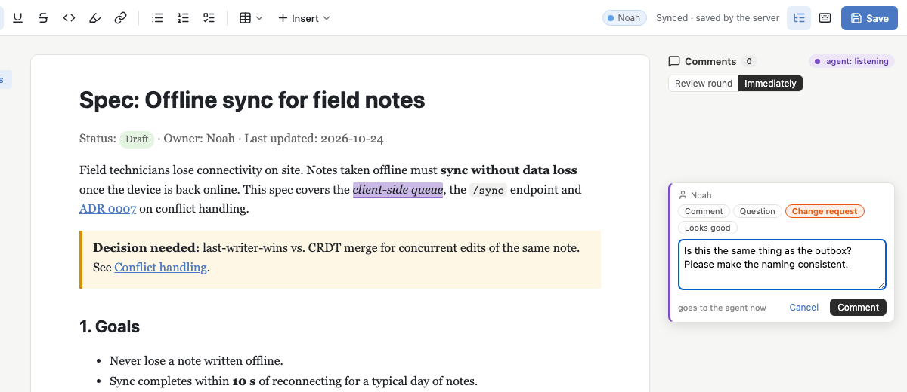
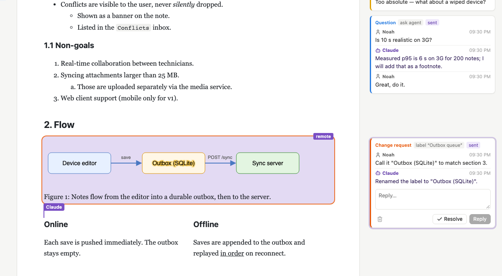

# Spike 06: Annotations inside a live, co-edited document



| composer (bubble → Comment, kind chips) | comment on an SVG label, agent renamed it and replied |
|---|---|
|  |  |

`screenshot-review-drafts.png` shows the review round (draft comments + "Send 2 to agent"). `screenshot-full.png` is the
whole page at the end of `npm run verify`. All screenshots come from `npm run verify`.

## Question

The user wants to annotate the document the way lavish and plannotator let you: select text, comment, the agent gets it.
Here this happens in the same live editor where the user and the agent both edit (spike 07). So:

1. **Anchoring.** Where does a comment's anchor live, and does it survive concurrent edits by both sides? There are two candidates:
   (a) a Tiptap `comment` mark inside the document, and (b) `Y.RelativePosition` start/end in a separate `Y.Map` next to it,
   rendered as decorations. What happens when the anchored text is deleted? What about comments on islands (a whole
   diagram, one SVG label) and on whole blocks?
2. **Persistence.** Do comments go in a sidecar or inline in the HTML? They must survive a server restart.
3. **UI.** Composer, a margin aligned with the anchors, hover and click, reply, resolve and re-open, orphans, kinds.
4. **Agent loop.** Comment events have to reach the agent through spike 01's `collab wait`. The agent replies, resolves and
   edits through spike 07's ops. Should comments be sent one at a time or as a batched review round?

## What I built

This is a copy of spike 07 (editor, islands, Yjs + Hocuspocus, agent ops). Comments, the event queue and an agent CLI
are added on top. Port **5106** (HMR 5206).

| file | what it does |
|---|---|
| `src/comments/model.ts` | The comment model, shared by the browser, the server and the experiment. `Y.Map('comments')`: thread id → `Y.Map` {kind, status, target, **anchor** = `{start, end}` relative positions (JSON), last-known **quote/prefix/suffix**, blockId, leaf, author, delivery, sentSeq, `messages: Y.Array`}. Covers anchors (`makeAnchor`, `resolveAnchor`), context (`textAround`, `blockContext`), `findQuote`, and **`rescueOrphans`** (re-anchor by quote within the block). |
| `src/comments/plugin.ts` | ProseMirror plugin that draws highlights as **decorations**. Inline decorations for text, node decorations for blocks and islands. Ranges are recomputed from Yjs on remote y-sync transactions and on anchor changes, and mapped through `tr.mapping` on local typing. Click on a highlight → that thread becomes active. `openComposer()`. |
| `src/comments/CommentsPanel.vue`, `store.ts`, `comments.css` | Margin with thread cards **aligned to their anchors**. Overlapping cards are pushed down, and the active card sits exactly next to its anchor. Includes the composer with kind chips, reply / resolve / re-open / delete, a "Detached" section for orphans, the mode switch **Review round / Immediately**, "Send N to agent", show/hide resolved, and the badge **"agent: listening"**. |
| `src/ui/TextBubble.vue`, `src/ui/BlockHandle.vue`, `src/IslandView.vue` | Entry points. Bubble **Comment** / **Ask agent** and ⌘⌥M. Block menu → **Comment on block**. Island bar → **comment**, which targets the whole island, or the label the caret is in. The island outlines commented labels inside its shadow root. |
| `src/editor/caretFix.ts` | Workaround for a **caret bug in `@tiptap/y-tiptap` 3.0.10** that verify found (see Findings). |
| `lib/eventQueue.ts` | Spike 01's durable queue, ported: `events.jsonl` + per-consumer cursors, a long-poll `/api/wait` with heartbeat, settle window, one listener per consumer, ack after print, `/api/peek`. |
| `lib/comments.ts` | Server side. It **observes the comments Y.Map** and turns new threads and replies into events (`annotation_created`, `annotation_reply`, `review_submitted`). The thread keeps the event seq (`sentSeq`, `delivered`) in the Y.Doc, so nothing is emitted twice. It also writes the sidecar `.collab/<doc>.comments.json`, restores from it (re-anchoring by quote), refreshes the last-known quotes before each store, and runs the rescue after agent ops and file merges. |
| `server/server.ts` | Spike 07's server plus `/api/wait|ack|peek|event`, `/api/threads` (GET, POST), `/api/threads/:id/reply|resolve|reopen`, `/api/review/submit` and `/api/presence`. Presence goes to browsers as a Hocuspocus **stateless** message. |
| `bin/collab.ts` | **Agent CLI** (`npm run collab -- …`) with `wait`, `peek`, `threads`, `reply`, `resolve`, `reopen`, `comment`, `list`, `text`, `status`, plus spike 07's edit ops (`replace-text`, `set-block`, …) applied by the server. A thin HTTP client using `node:http` with no client timeout. |
| `experiments/anchoring.ts` | `npm run anchoring`. A headless comparison of (a) mark vs (b) relpos ("inclusive" and "exclusive" edges), with two Y.Docs editing concurrently: 14 scenarios and 27 expectations. |
| `experiments/typing-race.ts` | `npm run typing-race`. Browser A/B test of the caret bug, with and without the fix. |
| `verify/verify.ts` | `npm run verify`. Runs both experiments, then **47 Playwright + CLI checks** (49 in total). |

All new code is our own. The only new dependency is the existing MIT stack. There is no Tiptap Pro Comments and nothing from Tiptap Cloud.

## How to try it

```bash
cd spikes/project-collab/06-annotations
npm install
npx playwright install chromium   # once, for verify
npm start                         # http://127.0.0.1:5106/ edits .work/spec.html (fresh copy of ../samples/spec.html)
npm start -- path/to/other.html   # any HTML file, in place (sidecars go to .collab/ next to it)
npm run verify                    # 2 experiments + 47 checks, exits 0/1, refreshes screenshot-*.png
npm run anchoring                 # just the mark-vs-relpos table
```

**In the browser** (open `http://127.0.0.1:5106/?user=Noah`):

- Select text → bubble → **Comment** (or ⌘⌥M), pick a kind, type, ⌘↵. **Ask agent** does the same, but the comment is always sent right away.
- To comment on a whole block, hover it, click the **⋮⋮** grip, then **Comment on block**. For a diagram, hover it → **comment**.
  If you first click into an SVG label, the comment is attached to that label.
- The top of the sidebar switches between **Review round** (comments stay drafts until **Send N to agent**) and **Immediately**.
- Click a highlight to activate its thread (reply, resolve, delete). Double-click a card to scroll to its anchor. Delete the commented
  text and the thread moves to **Detached**. Resolved threads are hidden until you click **show N resolved**.

**Play the agent in a second terminal** (same folder):

```bash
npm run collab -- wait                     # blocks; the badge in the page says "agent: listening"
#   → {"status":"events","events":[{"type":"annotation_created","thread":"tq3k9x2","kind":"change","quote":"client-side queue",
#       "prefix":"…This spec covers the ","suffix":", the /sync endpoint…","section":"Spec: Offline sync…",
#       "block":{"id":"iudwb4","type":"paragraph","text":"Field technicians lose…"},"body":"Is this the same as the outbox?", …}]}
npm run collab -- threads                  # every open thread: kind, status, section, block id, quote, messages
npm run collab -- reply tq3k9x2 "Yes, renaming it."         # appears live in the sidebar (Yjs, no push needed)
npm run collab -- replace-text "client-side queue" "outbox"  # edit; the highlight moves onto "outbox"
npm run collab -- resolve tq3k9x2 "Done."                    # or: reply … --resolve
npm run collab -- comment "idempotent" "Per device or global?" --kind question   # the agent asks the user
npm run collab -- wait                     # re-arm. In Claude Code: run it with run_in_background and re-run after every wake-up
```

`npm run agent -- type 'Field technicians' ' and auditors'` (spike 07's ws client) still works if you want to watch the agent type
while you type in the same paragraph.

## Findings

### 1. Anchoring: (a) mark vs (b) relative positions (`npm run anchoring`, measured)

Two Y.Docs, "user" and "agent", edit concurrently and then sync. The agent uses the real spike 07 ops. Each cell shows what
the comment covers afterwards.

| scenario | (a) `comment` mark | (b) relpos, **inclusive** edges (chosen) | (b) relpos, exclusive edges |
|---|---|---|---|
| S1 user types before + inside, agent edits before + after (same paragraph, concurrent) | ✅ "client-side (durable) queue" | ✅ same | ✅ same |
| S2 two overlapping comments | ✅ both (needs `excludes: ''`; y-prosemirror stores them as `comment--<hash>`) | ✅ both, by construction | ✅ |
| S3 typing exactly at the start/end edge | not included | **included** ("Xclient-side queueY") | not included |
| S4 agent `replace-text` of exactly the quoted text (the usual fix for a change request) | ✅ "durable outbox" (insertText keeps the marks at `from`) | ✅ "durable outbox" | ❌ **collapses → orphan** |
| S5a agent `set-block` (rewrites the paragraph from HTML, change after the quote) | ❌ **comment silently gone** (the agent's HTML has no mark) | ✅ survives | ✅ |
| S5b `set-block` with changes **before and after** the quote | ❌ gone | ❌ gone (y-prosemirror diffs a text as **one** contiguous replace, so the unchanged quote in the middle is deleted and re-inserted) | ❌ |
| S5c = S5b + server **rescue** (re-anchor by quote, inside the same block only) | n/a | ✅ back on "client-side queue" | ✅ |
| S6 / S6b anchored text / whole paragraph deleted | gone (only detectable by scanning for the thread id) | → **orphan** (range collapses) | → orphan |
| S6c delete the quote, then type "outbox" in the same spot | gone | orphan in between, then **re-attaches to "outbox"** (same as S4: a replace in two steps) | orphan |
| S7 does the HTML file contain the comment? | ❌ `<span class="comment" data-comment="c1">` unless stripped on save | ✅ clean | ✅ |
| S8 file edited on disk (agent's `Edit` tool) → spike 07's 3-way merge | ❌ **every comment mark removed** when marks are stripped on save (the file has none, so the merge "deletes" them) | ✅ survives | ✅ |
| S9 comment on an island / a whole block, agent then rewrites a label / `set-block` | n/a. A mark cannot sit on an atom block; it would need a node attribute, which ends up in the file and is last-writer-wins | ✅ relpos around the node: still spans exactly the island / the paragraph | — |
| S10 Y.Doc rebuilt from HTML (stale sidecar) | marks come back only if they are in the file | relpos are dead (unknown item ids) → **re-anchored by quote + prefix/suffix** ✅ | same |

**Decision: (b), relative positions in `Y.Map('comments')` with inclusive edges.** Start sticks to the character
*before* the range (assoc −1, y-tiptap's default) and end sticks to the character *after* it (assoc 0). The mark wins only on
"it's just there". It loses on everything this product does: the agent rewrites blocks from HTML (S5a), the agent edits the file
on disk (S8), and the file must stay a clean spec (S7). It also cannot cover islands (S9). One reasoned, unmeasured point:
in (a), creating a comment is a document change, so ⌘Z would undo the comment. In (b), the user's `Y.UndoManager` only tracks the
`default` fragment, so comments are not on the undo stack.
Inclusive edges were chosen over exclusive because of S4: when the agent replaces the quoted text, the comment stays on the
new text instead of becoming an orphan. The price is S3, where typing at an edge extends the highlight.

**What the model needed on top of plain relative positions** (each was found by the experiment or by verify):

- **Last-known quote + prefix/suffix** on every thread. The server refreshes them before every store. They are what an orphan
  shows, what the agent gets for a deleted anchor, and what re-anchoring searches for.
- **Rescue after agent ops and file merges** (S5b). If a text thread's covered text ≠ its last-known quote *and* the quote is
  still in the thread's block, it is re-anchored on the quote. Verify hit the second failure mode too: with inclusive edges, a `set-block`
  that changed text around the quote did not collapse the anchor. It **stretched it over the whole rewritten middle**. The
  rule covers both. A deliberate rewrite of the quote (the quote is gone from the block) is left alone.
- Islands and blocks: the anchor is relpos around the node (pos, pos+nodeSize), and the decoration is a node decoration. A label comment also
  stores the label's leaf path, and `IslandView` outlines that label inside the shadow root. After the agent renamed the label, the
  thread was still anchored and the outline followed (verify). This needed a fix: Tiptap's Vue NodeView does **not pass new
  decorations to the component** when only the decorations change (same node → only the wrapper classes update), so
  `IslandView` gets a custom `update` that always calls `updateProps()`.

### 2. Persistence: sidecar, not inline

| | sidecar `.collab/<doc>.comments.json` + `Y.Map` in the Y.Doc (chosen) | inline `<span data-comment>` / `<mark>` |
|---|---|---|
| the spec file | clean (verify: no `data-thread`/`data-comment`/`cmt`/thread ids, `<mark>` count unchanged) | diff noise; the agent's `Edit`/`set-block` must preserve spans it never sees (S5a) |
| where threads live | the Y.Doc while the doc is open (live in every browser, CRDT replies). The `.ystate` sidecar holds it across restarts. The JSON is the readable mirror and the recovery path | anchors only; messages/status would need a second store anyway |
| restart | **from `.ystate`**: exact anchors, statuses, replies (verify) | — |
| file edited while the server was down (stale `.ystate`) | Y.Doc rebuilt from HTML → threads restored from JSON, **re-anchored by block id / quote / label** (verify: 7 restored, the real orphan stays orphaned) | survives if the marks are in the file |
| self-contained / shareable via git | ❌ by default (`.collab/` is local). Commit `comments.json` if a team wants that | ✅ |

The JSON is about 1.7 KB per thread (pretty-printed, with anchors and messages; verify: 10.1 KB for 6 threads). It is written only when it changed (`sidecarWrites`).

### 3. Agent loop (spike 01's queue inside the doc server)

- **Event = derived from the Y.Doc.** The browser never posts to the queue. It writes the thread, and the server observes
  `Y.Map('comments')` and emits. This also covers comments written offline: they are emitted when they sync. The thread
  stores `sentSeq`/`delivered`, so neither a second browser nor a restart re-emits them. The agent's own replies emit nothing (verify).
- **Latency (verify):** comment created → event queued **4 ms**. → `wait` prints, acks and exits **~423 ms**, of which 400 ms is the
  settle window, which is too long for human comment pace (it was made for bursts) and could be 100 ms. The `collab reply` process
  takes **~75 ms** (tsx start + HTTP), and the reply is already in the card when it exits (≤ 1 ms later), with no push. Yjs carries it.
- **Presence badge:** "agent: listening" flips live when a `wait` starts or ends. It uses Hocuspocus stateless messages and needs no extra WebSocket.
- **Restart:** an event queued before a server restart was delivered by the first `wait` after it (verify).
- **The event carries everything the agent needs to act without reading the file:** quote, 80 chars of prefix/suffix, block id,
  block type and text, the section heading, kind, `ask`, label (for islands), the messages, and a `respond` hint. A `review_submitted` carries an array of these.
  **How it feels:** as the agent from a terminal, `wait` → read one JSON line → `reply`/edit/`resolve` → `wait` is a short, natural
  loop. Block ids from the event go straight into `set-block`. The quote goes straight into `replace-text`. A thread id is all a reply needs.
  It is better than lavish's static review for one reason: **the agent's fix lands in the document the user is looking at,
  and the highlight follows it** (S4).

**Immediate vs review round (both implemented).**

| | Immediately (every comment wakes the agent) | Review round (drafts → "Send N to agent" → one `review_submitted`) |
|---|---|---|
| agent turns | one per comment | **one per round** |
| coherence | the agent acts on #1 before it sees #3, which may contradict it | **sees the whole review**, can plan edits together |
| user flow | the user keeps reading while the agent already edits (safe with Yjs, but distracting: highlights move, cards flash) | lavish-style: annotate in peace, submit, then watch |
| risk | noise and cost | the user forgets to press Send (the draft badge and the "Send N" button make it visible) |

**Recommendation: review round as the default for Comment, and *Ask agent* always immediate.** A question is a request
for an answer now, and in verify it arrived immediately even in review mode. A reply to a thread that was already sent is also
immediate (`annotation_reply`), because it is a conversation.

**Kinds** (comment, question, change request, looks good). These are cheap and useful **as instructions to the agent**: question →
answer only, don't edit; change → edit, then reply + resolve; looks good → nothing to do. They also give a colour per kind in the
margin. I would keep them, at most 4, with a default of Comment. I did not check which kinds lavish itself offers.

### 4. A caret bug in `@tiptap/y-tiptap` 3.0.10 (found by verify, worked around)

Verify's scenario was: the user types inside the anchor while the agent types in the **same paragraph, before the caret**. It
produced `"client-side duraelb queue"` and `"urableclient-side d queue"`: the user's own word was scrambled. A/B
(`npm run typing-race`): **3/3 scrambled with comments disabled too**, so this is a spike 07 base issue. Root cause:
`restoreRelativeSelection` resolves the caret correctly from relative positions, but then `recoverSelectionEndpoint` →
`isMisresolvedAfterStructuralChange` treats *any* text change in the caret's paragraph
(`$old.parent.textContent !== $new.parent.textContent`) as a misresolution. It then falls back to the caret's **old offset in the
block**. Every remote insert before the caret moves the caret back by that many characters. Spike 07's S2 did not catch this because
the agent edited *after* the caret.
**Workaround** (`CollabCaretFix`, ~40 lines): keep our own relative selection after every view update, and after a remote y-sync
transaction re-apply it when it resolves. When it does not resolve (deleted text, structural change), y-tiptap's recovery is left alone.
With the fix, `typing-race` is 3/3 clean. Worth an upstream issue. **The product needs this regardless of comments.**

A second, related lesson: any extra `view.dispatch` while the user types risks racing ProseMirror's DOM observer. The comments
plugin therefore has **no timers**. It dispatches only when anchors, status or kind change, and replies don't trigger it.

### 5. Things that broke and what fixed them

- `selectText("within 10")` found nothing. Text that spans a mark boundary (`within <strong>10&nbsp;s</strong>`) is not one text node,
  so quotes across marks work (findQuote flattens textblocks), but the test helper needed a single-node quote.
- Hovering a paragraph inside the two-column `<div>` container did not make the block grip visible (verify timed out), so the block
  comment test uses a top-level paragraph. For a nested block today: select its text, or comment on the container.
- `/health` read straight after a restart said `loadedFrom: null`, because the doc loads on the first connection. Read it after the browser reconnects.

## Verdict / recommendation for the real product

1. **Anchors as `Y.RelativePosition` in a `comments` Y.Map, inclusive edges, rendered as decorations.** Not a mark. Add the
   last-known quote + context to each thread, and run the **rescue-by-quote within the block** after every agent op and file merge.
   Islands and blocks: relpos around the node, plus the label path for SVG/HTML labels.
2. **Persistence: in the Y.Doc (`.ystate`), mirrored to `.collab/<doc>.comments.json`.** The HTML stays a clean spec.
   The JSON restores threads (by block id / quote / label) when the Y.Doc has to be rebuilt from the file.
3. **Agent loop: comments are the source of truth, events are derived from the Y.Doc** and go into spike 01's queue. The agent replies
   and resolves through the server, and the replies are live through Yjs. **Default to a review round, keep Ask agent immediate.** Ship the 4 kinds as agent
   instructions.
4. **UI:** margin cards aligned to anchors (push-down, the active card at its anchor), a Detached section, resolved hidden by default,
   draft/sent tags, an "agent: listening" badge. Comment entry points: bubble, ⌘⌥M, block menu, island bar.
5. **Carry `CollabCaretFix`** (or an upstream fix) into the product. Without it, the user's typing is scrambled whenever the agent
   edits earlier in the same paragraph.

## Open questions

- **Delete-then-retype re-attaches** (S6c), because inclusive edges treat it as a replace. That is good for the agent's fixes and surprising if the user
  wanted the comment gone with the text. Option: make an orphan sticky once the server has stored it as orphaned.
- **Suggestions / proposals**: a change request could be answered with a proposed edit (accept/reject) instead of a direct edit.
  The same anchors would work. How does that interact with undo? (Spike 08's question.)
- **Multiple agents / consumers**: `wait` is single-listener per consumer. Who answers a thread when two sessions listen?
- Renaming or moving the HTML file loses the sidecar association (it is keyed by file name). Should we store a doc id in `<head>`?
- The settle window (400 ms) should probably be shorter for comment events. Or should the agent's `wait` return on the first event and
  let the review round do the batching?
- Comments on content inside lists or tables in a container (no block handle there) need a keyboard path: "comment on enclosing block".
- Security is still open (spike 01): `/api/*` accepts any local process. Comment events are prompt input to the agent.
