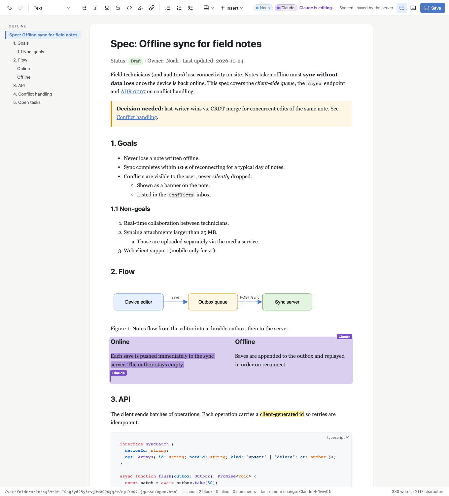

# Spike 07: Collaboration (Yjs + self-hosted Hocuspocus). Can user and agent edit in parallel?



(`screenshot-full.png` is the whole document at the end of `npm run verify`.)

## Question

Files on disk cannot carry two writers at once: while the user types in the browser, the agent's `Edit`
lands on a file that is already stale, and someone's change is lost (spike 03 measured it: the naive and
2-way merges lose the user's typing). Does **Tiptap collaboration (Yjs)** solve this? Concretely:

1. Can a self-hosted **Hocuspocus** server hold the document as a Y.Doc, seed it from the HTML file, and
   write HTML (+ a Yjs sidecar) back, so the file on disk stays the artefact the agent and git see?
2. Can **the agent be a collaborator**: a second client with its own caret that edits through the same
   schema, and how should it address content (block ids vs text search)?
3. What happens in every concurrency case: different paragraphs, same paragraph, same word, whole
   paragraph, islands (SVG labels), undo, offline/reconnect, server restart?
4. What does the user see while the agent edits?
5. What if someone (the agent's natural instinct) edits the HTML **file** while the document is live?

## What I built

Copy of spike 05 (editor UI + spike 04 islands) with collaboration on top. Port **5107** (HMR 5207).

| file | what it does |
|---|---|
| `server/server.ts` | One Node process per document: Vite middleware for the app, **Hocuspocus embedded** on `ws://…/collab` (same http server, via `crossws`, exactly as Hocuspocus' own `Server` class wires it), `GET /doc`, `GET /doc/state` (live text + blocks), `POST /doc/flush`, `POST /agent/op` (agent edit through a *direct connection*), `GET /health` (stats). |
| `lib/collabDoc.ts` | **File ⇄ Y.Doc glue.** `load`: sidecar `.collab/<doc>.ystate` if its recorded hash matches the HTML file, else parse the HTML headlessly (jsdom + the spike 04/05 schema incl. islands) and seed the Y fragment **server-side**. `store` (debounced by Hocuspocus, 800 ms / max 3.2 s): Y.Doc → body HTML → prettier → `expandIslands` → spliced into the file's own shell (`<head>` untouched) → sidecar + meta `{htmlHash}`. `watch`: `fs.watch` on the directory, hash compare against our own last write (no echo loop), **3-way merge** of external edits (fork at base → `updateYFragment` → merge the fork's update into the live doc). |
| `lib/agentOps.ts` | The agent's operations as ProseMirror `Transform`s on the doc read from the Y fragment (`initProseMirrorDoc` gives the Y→PM mapping), applied with `updateYFragment` = the exact reconciler y-prosemirror uses for local editor changes. Unchanged nodes keep their identity, so only the touched block becomes CRDT ops (a `set-block` is **74–94 bytes**). Ops: `replace-text`, `insert-after-heading`, `append-section`, `set-block`, `set-island-text`, `insert-after-text`; plus `locate` (relative positions for the agent's selection) and `listBlocks`. |
| `agent/agent.ts` | **The agent CLI** (`npm run agent -- …`). Default `--via ws`: joins as a second Hocuspocus client, awareness user "Claude" (purple), selects the target, edits, keeps the caret visible for `--linger` ms, exits. `--via server`: `POST /agent/op`. `type <find> <text>` types one character per op (live demo). Honours the island soft lock (below). |
| `lib/pipeline.ts` | Headless load/save path from spike 03/04 (jsdom, prettier, islands) + Yjs conversions + `withBlockIds`. |
| `src/extensions.ts` | Spike 05 schema + **`UniqueID`** (block ids, `data-bid`, see below) + `Collaboration` + `CollaborationCaret` + `AgentHighlight`; StarterKit's `undoRedo` off in collab mode; our own `Y.UndoManager` (bug workaround, see findings). |
| `src/editor/agentHighlight.ts` | Decoration plugin: blocks changed by a **remote** y-sync transaction (compared by block id, so a moved block does not light up) flash in the remote user's colour and fade over 2.5 s, with a small name tag. Skips the initial render and the user's own undo/redo. |
| `src/App.vue`, `src/ui/Toolbar.vue`, `src/collab.css` | Y.Doc + `HocuspocusProvider` created in setup (no `setContent` anywhere), presence chips from awareness, **"Claude is editing…"** while a remote peer has a caret, status "Synced · saved by the server / Syncing… / Offline — edits are kept locally", ⌘S = flush now. `?user=Name&color=%23hex` names the local user. |
| `src/IslandView.vue`, `src/islands/env.ts` | Spike 05 island editing + the **island soft lock**: focus inside an island publishes `island: <opening tag>` through awareness; the agent waits (`--lock-timeout`, default 2 s) and then refuses with exit 5 instead of overwriting the island the user is typing in. |
| `verify/verify.ts` | **65 Playwright checks** + 6 `OBSERVED` lines, driving a real browser as the user and the agent CLI as a child process (table below). |

Everything added is MIT: `@hocuspocus/server` + `@hocuspocus/provider` 4.7, `@tiptap/extension-collaboration`, `@tiptap/extension-collaboration-caret` (the v3 name of the old `collaboration-cursor`), `@tiptap/extension-unique-id` (MIT in v3; it was Pro in v2), `@tiptap/y-tiptap`, `yjs`, `y-protocols`, `crossws`, `ws`.

## How to try it

```bash
cd spikes/project-collab/07-collaboration
npm install
npx playwright install chromium   # once, for verify
npm start                         # http://127.0.0.1:5107/  — edits .work/spec.html (fresh copy of ../samples/spec.html)
npm start -- path/to/other.html   # any HTML file, in place (sidecar goes to .collab/ next to it)
npm run verify                    # 65 checks + observations, exits 0/1, refreshes screenshot-*.png
```

Watch the agent edit live:

1. Open http://127.0.0.1:5107/?user=Noah (a second tab with `?user=Pat` shows two human carets too). Put the caret into the intro paragraph and keep typing.
2. In another terminal, let the agent type character by character: `npm run agent -- type 'Field technicians' ' and auditors' --type-delay 80` — a purple caret labelled **Claude** appears, the toolbar says **Claude is editing…**, the paragraph flashes purple.
3. More agent edits (block ids come from `npm run agent -- list`):
   ```bash
   npm run agent -- list
   npm run agent -- replace-text 'conflict handling' 'conflict resolution'
   npm run agent -- insert-after-heading '3. API' '<p>Batches are capped at 50 operations.</p>'
   npm run agent -- set-block '#goals' '<h2 id="goals">1. Goals and scope</h2>'
   npm run agent -- append-section '<h2 id="rollout">6. Rollout</h2><p>Phase 1: 20 pilot devices.</p>'
   npm run agent -- set-island-text '>Sync server<' '>Sync API<'      # click into an SVG label first → exit 5 "locked by Noah"
   npm run agent -- --via server replace-text 'Owner: Noah' 'Owner: Noah & Claude'
   ```
4. Edit `.work/spec.html` in your editor while the page is open: the change appears in the browser within ~200 ms, your unsaved typing stays. `curl -s localhost:5107/health` shows `externalMerges`, `echoesIgnored`, `stores`.
5. Kill the server (Ctrl-C), start it again: the page reconnects (HMR on `npm start` also reloads it), `/health` says `loadedFrom: sidecar`.
6. Go offline: type `__provider.disconnect()` in the console, edit, run an agent command, then `__provider.connect()` → both edits are there.

## Findings

### Concurrency scenarios (`npm run verify`, 3 runs, all green; measured, not hoped)

| # | scenario | observed | acceptable? | mitigation / note |
|---|---|---|---|---|
| S1 | user types in paragraph A while the agent `set-block`s paragraph B (online, overlapping) | both survive; B keeps its block id; browser shows the "Claude" caret + selection, "Claude is editing…", and B flashes purple; agent update **74–94 B**, connect 8–100 ms | **yes** | — |
| S2 | same paragraph, different offsets (user types "Note: " at the start, agent replaces the last words) | both survive, character-level merge | **yes** | — |
| S3a | **same word**: user types `X` inside "connectivity" while offline, agent replaces "connectivity" → "network access" | converged; agent text present; the user's `X` survives as an **orphan** (`…lose Xnetwork access…`); the caret stays glued to the `X` (relative positions), no jump | partly | Yjs cannot know the `X` belonged to the deleted word. Product: agent edits on a paragraph a human caret sits in should be **proposals** (highlight + accept) or wait for a pause; show "Claude changed this while you typed". |
| S3b | agent `set-block`s the **whole paragraph the user is typing in** (same node type) | the reconciler turns it into a text diff, so the user's ` USER-ADDITION` at the end survives, caret stays; no duplicate paragraph | mostly | If the replacement is a different node type (p → h2) the Y element is deleted and recreated and concurrent typing in it **is lost** (not measured here). `set-block` should keep the type when only text changes, or use `replace-text`. |
| S4a | **island** (SVG labels): user edits label 1, agent edits label 3 **400 ms apart** (online) | both survive (the agent reads the island after the user's edit arrived) | yes | — |
| S4b | same island, **concurrent** (user offline) | **one side lost** — the island is one `html` attribute = one Y.Map key, last writer wins (agent won in 2 of 3 runs, user in 1: it depends on Yjs client ids) | **no** | **Soft lock implemented**: focus inside an island publishes `island: '<figure class="diagram">'` via awareness; `set-island-text` waits up to `--lock-timeout` and exits 5 "locked by Noah" (verified: 408 ms wait, named the user; goes through after the user leaves). Real fix: per-leaf storage (one Y key per text leaf, or island = Y.Map of leaf texts + template) — see open questions. |
| S5 | **undo**: user types, agent edits elsewhere, ⌘Z | ⌘Z removes only the user's text (Y.UndoManager tracks local origins), the agent's edit stays; ⇧⌘Z redoes — **after a fix**, see "Things that broke" | **yes** | — |
| S6 | browser **offline** (`provider.disconnect()`) while the agent appends a section; user types offline | status "Offline — edits are kept locally"; on reconnect both edits present, outline updated, browser text == server text | **yes** | Pending offline edits live only in the tab's memory: add `y-indexeddb` in the product. |
| S7 | **file edited on disk** while live (user typing at the same time) | watcher merged it as a **759 B** update in **37 ms**; browser shows it; user's concurrent typing kept; merged document written back; our own write recognised by hash (`echoesIgnored`), no loop | **yes** | 3-way (fork at base) is required — spike 03 showed 2-way loses the user's text. |
| S8 | agent `--via server` (direct connection) | edit in 1–3 ms, 32–125 B; caret visible too once the server's awareness state is set with `setLocalState` | yes | see trade-off below |
| S9 | **server restart** (SIGTERM, start again on the same port) | server stores on exit; HTML on disk has every edit, `<head>` byte-identical; browser reconnects **without reload** (no Vite client ws in verify) and shows the same text; `loadedFrom: sidecar`. File edited while down → hash mismatch → `loadedFrom: html`, browser shows the edit | **yes**, with a caveat | after a rebuild from HTML the Y.Doc has a **new history**; a browser with pending offline edits against the old history would lose them (Yjs cannot merge across documents). Product: on mismatch, 3-way merge the file into the sidecar state instead of discarding it. |

Convergence (browser text == server text) was checked after every scenario: 65/65 checks pass, three runs in a row, no flakes.

### Yjs vs a file: what it actually buys

- **Different places** (S1, S2, S6, S7): solved outright. No locking, no "reload to see changes", no lost typing. The agent's edit lands as a small update that the browser applies in place while the user keeps typing.
- **Same characters** (S3a): the CRDT keeps *everything*, which produces orphans. That is the correct merge and still the wrong document. No format fixes this; it needs UX (proposal mode, "edited while you typed" badge) or an agent rule ("don't rewrite the paragraph the caret is in").
- **Atoms** (S4b): an island is one attribute, so Yjs degrades to last-writer-wins for the whole SVG. Spike 03 predicted this; measured here.
- **The file stays the artefact.** The agent never needed anything but HTML: `set-block`/`insert-after-heading` take HTML snippets, parsed by the same spike 04 pipeline. The file on disk is written from the Y.Doc; it is always the canonical rendering of the live document (plus `data-bid`s).

### Agent addressing: block ids vs text search

Both are implemented, so the trade-off is measured, not guessed:

| | block ids (`data-bid="k3f9ax"`, `UniqueID`) | text search (`replace-text`, `insert-after-heading`) |
|---|---|---|
| unambiguous | yes; `set-block k3f9ax` hits exactly one block; survives rewording | no; "connectivity" may occur twice; headings are matched by substring |
| survives round trips | yes: `UniqueID` renders `data-bid`, spike 04's `PreserveAttributes` excludes it from `htmlAttrs`, verified across store → load → sidecar → restart | n/a |
| what it does to the file | **+1 KB / 60 attributes** on the 7.3 KB sample (7,266 → 9,163 B together with prettier's reflow); every `<p>` now has an id; git diffs show them once | nothing |
| agent ergonomics | needs `list` first (one round trip), then the id | the agent already knows the text it wants to change |
| islands | excluded (their placeholder must stay attribute-free), use `#id` or text | `set-island-text` by substring |
| extra value | **the browser uses them** to tell "changed" from "moved" in the highlight plugin; a reviewer UI (accept/reject per block) will need them anyway; `set-block` keeps the id when 1 block replaces 1 block | — |

Author-given `id`s (`#goals`, `#error-codes`) are also accepted by `set-block`. Recommendation: keep both. Use text search for prose edits (it is how an agent thinks), block ids for structural edits and for anything the UI must track. Make the id attribute name part of the format (`data-bid` here; a short 6-char id, not a UUID) and generate ids server-side at load so the first browser never writes ids back by itself.

### Agent as a WebSocket client vs editing the server's Y.Doc directly

| | `--via ws` (Hocuspocus client, default) | `--via server` (`POST /agent/op` → `openDirectConnection`) |
|---|---|---|
| latency | connect 8–10 ms warm, ~100 ms cold + tsx startup ≈ 0.4 s | 1–3 ms (plus the HTTP call) |
| awareness / caret | native: `user` + `cursor` like a browser; the agent selects its target first, then edits, then lingers | works too, through `document.awareness.setLocalState(...)` (note: `setLocalStateField` is a **no-op** there because Hocuspocus initialises the server's local state to `null`) |
| undo semantics | agent edits are a remote origin for everyone → never on the user's undo stack | same (direct connection = `local` origin, still not the browser's) |
| works when the server is down | no (and neither does anything else — the doc is in the server) | no |
| code path | needs the whole schema + jsdom in the CLI (it already does for parsing HTML) | the server owns schema + jsdom; the CLI is a thin HTTP call |
| failure modes | own Y.Doc copy; must wait for `hasUnsyncedChanges === false` before exiting (done) | runs inside the server process: a throwing op is a server bug surface |

Recommendation: **ws client for presence and demos, server endpoint for the skill.** The skill's CLI should be thin (`collab edit …` → HTTP), the server does the parsing; the server sets awareness so the caret still shows. Keep the ws path for a long-running "agent session" that types progressively.

### Persistence: HTML on disk + Yjs sidecar (spike 03's D1), seeding and the empty-doc race

- The **server seeds** the Y.Doc in `onLoadDocument` before any client syncs, so the "first client initialises an empty doc" race cannot happen: the browser never calls `setContent`, `content` is unset, and `UniqueID` finds ids already present. Verified: the first browser produces a 26 B write-back only (StarterKit's `TrailingNode` adds the trailing `<p>` after the last island, the spike 04 behaviour).
- Load from the sidecar when `meta.htmlHash === sha1(file)`, else rebuild from HTML (and store immediately so file, sidecar and Y.Doc agree). Sidecar: **12.9 KB** for the 9 KB file, grows with history (GC on).
- Store: Hocuspocus debounces `onStoreDocument` (800 ms, max 3.2 s), stores on last disconnect, and we store on SIGTERM. Writes are skipped when the HTML is byte-identical (`storesSkippedUnchanged`). 16 stores in a verify run of ~90 s of constant editing.
- Documents unload when the last connection closes and reload from the sidecar on the next one (fast; the agent CLI exercises this on every call when no browser is open).

### Disk file vs Y.Doc (external edits)

Implemented as spike 03 proposed and kept small: `fs.watch` → 150 ms settle → hash ≠ last own write → parse file → `baseDoc.eq(fileDoc)` short-circuit (formatting-only) → fork at the **base state** (= Y state the file was produced from, kept in memory and in the sidecar) → `updateYFragment(fork, fileDoc)` → apply the fork's update to the live doc. After the merge the base moves to the fork's state (so a second external edit does not re-apply the first). Measured: 759 B update, 37 ms, concurrent typing preserved, write-back converges, zero echoes mis-detected. What it does *not* do yet: base across restarts for a file edited while the server is down (then there is no live doc, a plain load is right — S9 shows the rebuilt path), and spike 08 should compare this against the agent CLI path in depth (token cost, failure modes, which one the skill should prefer).

### UX for agent edits

- Caret + selection with name tag (`CollaborationCaret`, default markup, our CSS). The agent **selects the target first** (`locate`) and waits 400 ms before editing, so the user sees *where* something is about to change, then the caret sits at the end of the change for `--linger` ms.
- **"Claude is editing…"** in the toolbar while any remote peer has a caret; chips for everyone online (pulsing dot while active).
- **Fading highlight** of changed blocks with a name tag, by block id; the status bar lists the last remote change (`last remote change: Claude → k3f9ax`). Attribution is by presence (Yjs updates carry client ids, not users) — correct with one agent, approximate with several peers.
- Status: "Synced · saved by the server", "Syncing…", "Offline — edits are kept locally". ⌘S flushes to disk now (there is nothing else to save).

### Things that broke and what fixed them

- **Redo never worked** (S5): every `editor.registerPlugin()` (bubble menus, drag handle, link popover mount) makes ProseMirror destroy and re-create all plugin views; y-prosemirror's undo plugin view calls `undoManager.destroy()`, which removes the manager from its own `trackedOrigins`; Tiptap's Collaboration extension restores that once, and after the first cycle the manager stays untracked, so undo transactions never reach the redo stack (`can().redo()` always false). Fix: pass our own `Y.UndoManager` with `destroy` disarmed (`collabUndoManager` in `extensions.ts`). Worth an upstream issue.
- `HocuspocusProvider` with an explicit `websocketProvider` (needed for the `ws` polyfill in Node) does **not attach itself**: call `provider.attach()`.
- Server-side awareness: `setLocalStateField` is a no-op while the local state is `null` (Hocuspocus's default) → `setLocalState({user, cursor})`.
- Vite's client reloads the page when the dev server restarts (and in middleware mode it opens its ws server even with `hmr: false`): verify runs with `server.ws: false` so the provider's reconnect can be tested on its own. With `npm start` (HMR on) a server restart reloads the page, which is fine for a dev tool but loses unsynced offline edits.
- Two copies of `yjs` in the browser bundle ("Yjs was already imported") once `@tiptap/y-tiptap` was imported from app code: `resolve.dedupe` + `optimizeDeps.include` in `vite.config.ts`.
- The highlight plugin lit up **every** block on first load (initial render is a y-sync transaction from an empty doc) and on the user's own undo: skip `initialLoad` and `isUndoRedoOperation`.
- `Transform` has no `insertText` (that is `Transaction`): small helper that keeps the marks at the insertion point.

## Verdict / recommendation for the real product

**Yes, Yjs solves the parallel-editing problem for everything except two cases, and both are known and bounded.** Edits in different places, the same paragraph at different offsets, offline typing, external file edits and server restarts all merge without losing a character (65 checks, 3 runs). What remains:

1. **Same word / same characters**: the CRDT keeps both sides and produces orphans. Treat it as UX, not merge: the agent should not rewrite the paragraph a human caret is in (awareness tells it), or it should propose (highlight + accept) instead of apply. Spike 08 should design that.
2. **Islands are atoms**: one attribute, last writer wins. The soft lock (awareness) stops the common case in a dev tool (one human, one agent). The real fix is per-leaf storage for island text.

Architecture to keep:

- **HTML on disk + `.collab/<doc>.ystate` sidecar**, server-side seeding, debounced store with hash-guarded write-back, 3-way merge for external edits. The file remains the agent's and git's artefact; the Y.Doc is the live truth while a session is open.
- **Hocuspocus embedded** in the per-document server (one process, one port, `crossws` upgrade on `/collab`). No cloud, no Pro.
- **Agent = collaborator**: thin CLI → server endpoint (`/agent/op`) for the skill, ws client for live typing; awareness user "Claude"; ops in HTML; text search for prose, `data-bid` block ids for structure and for the UI.
- **UI**: carets with names, "X is editing…", fading per-block highlight by block id, status with offline state. Build accept/reject on the same block ids.
- Fixes to carry: own `Y.UndoManager`, `provider.attach()`, `setLocalState` on the server, `dedupe: ['yjs']`.

## Open questions

- **Islands**: store each text leaf as its own Y key (island = `Y.Map { template, leaves }`, NodeView writes one leaf) so two labels merge like two paragraphs. The same-leaf case stays LWW, which is fine for a label. Needs a custom Y binding for that node type, or a schema change (island → container of leaf nodes).
- **Proposal mode** for agent edits in a paragraph the user is in (S3a/S3b): decoration-based suggestions (`ychange`-style) vs a separate "pending" Y map. How does accept/reject interplay with the user's undo stack?
- Stale sidecar after an offline file edit: 3-way merge the file into the sidecar state at load (keep history) instead of rebuilding, so a browser with pending edits can still merge.
- Persist the browser's pending edits (`y-indexeddb`) so a reload (HMR, crash) during offline does not lose them.
- Block ids in the file: acceptable noise (+1 KB, one-time diff), or should ids live in the sidecar only (then the agent cannot use them from the file)?
- One Hocuspocus per document vs one per project (spike 01's question again); the ws path is `/collab`, the document name is the file name, so a per-project server is a small change.
- Security (spike 01's gap still open): `/agent/op` and `/collab` accept any local process; a per-session token is needed before this is a product.
