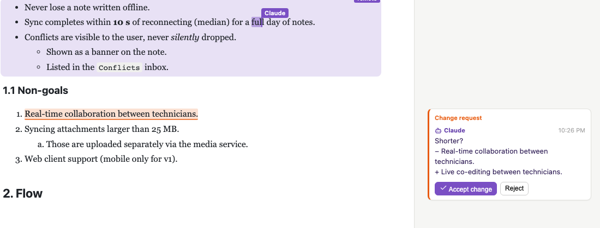

# Spike 08: How should the agent (Claude Code) edit the live document?



## Question

The document is open in the browser and the user may be typing in it. Which edit path should the skill tell Claude
to use?

- **P1:** Claude's own Read/Edit/Write tools on the HTML file. The server's file watcher 3-way-merges the file into
  the Y.Doc (spike 07).
- **P2:** CLI ops through the server (`replace-text`, `set-block`, `insert-after`, `move-section`, …). Claude never
  touches the file.
- **P3:** a new CLI `patch` op. Claude sends SEARCH/REPLACE blocks (the Edit tool's old/new strings). The server
  applies them to the live doc with a 3-way merge.
- **P4:** a snapshot workflow. `collab export` writes a scratch copy, Claude edits it freely with Edit, and
  `collab apply` merges it back as one 3-way merge.

The spike also covers reading (the file vs `collab read`), what to do when the user is typing in the block Claude
wants to change, and whether a suggestion mode is needed.

## What I built

This is a copy of spike 06 (editor, islands, Yjs/Hocuspocus, comments, event loop). Port **5108** (HMR 5208).

| file | what it does |
|---|---|
| `lib/livePatch.ts` | **New: P3 and the merge engine.** `render` (snapshot plus canonical HTML of the live doc), `applyEdits` (matching rules, errors), `outline`/`sectionLines`/`numbered` (reading), `humanCarets` (awareness → block), `mergeInto`/`reconcile` (the 3-way merge, now in **two passes**), `spliceDoc` (re-parse only the changed top-level chunks), `reuseNodes`/`modsOnly`/`align` (put the base node instances back wherever nothing changed; ids-aware weighted LCS), `withLiveMoves` (a moved block carries its *live* content) |
| `server/server.ts` | New endpoints: `GET /agent/read` (`format=outline`, `section=`, `lines=1`), `POST /agent/patch` (`dryRun`, `avoidCaret`, `propose`), `POST /agent/export` + `/agent/apply`, `POST /api/threads/:id/accept`. Every agent call goes to `.collab/agent-calls.jsonl` (characters sent). Flags `--naive-merge` (spike 07's one-pass full-reparse merge) and `--no-store-guard`, to reproduce the old behaviour. Carets in the block an op touches are reported as `warnings`. |
| `lib/collabDoc.ts` | The file watcher (P1) uses the same smart merge. **Store guard**: never overwrite a file edit the watcher has not merged yet. |
| `lib/agentOps.ts` | New P2 ops: `insert-after <find> <html>` (after the list item, table row or block that contains `find`) and `move-section <heading> <before-heading>` |
| `bin/collab.ts` | New commands: `read [--outline] [--section h] [-n]`, `patch [file] [--dry-run] [--avoid-caret] [--propose --message m]` (SEARCH/REPLACE blocks or JSON on stdin), `export`/`apply <scratch.html>`, `insert-after`, `move-section`, `accept <thread>` |
| `src/comments/*` | Suggestion-mode proof: a thread with a `proposal` shows **Accept change / Reject**. Accept re-applies the patch against the live doc. |
| `experiments/user-sim.ts` | The "user": headless Chromium that types a sentence every ~8 s at human speed (110 ms/char), round-robin through 8 places (several of them where the tasks edit). It first creates a change-request comment through the UI. Every sentence carries a marker (`u07`). Log: `.work/*.jsonl`. Stops on `<log>.stop` or after `--minutes`. |
| `experiments/check-loss.ts` | After a run: which logged sentences are intact, mangled or missing in the live doc and in the file, plus thread state and merge stats |
| `experiments/caret-structural.ts` | A/B of the caret/typing bug found in the P3 run (table in Findings §3) |
| `experiments/runs/` | Raw logs of the real runs (`p1`, `p1b`, `p2`, `p3a`, `p3`, `p3c`, `p4`): simulator log + loss report |
| `SKILL.md` | **Draft "Editing the document" section** for the product skill |
| `verify/verify.ts` | `npm run verify`: 46 checks + OBSERVED lines. A scripted, LLM-free version of the comparison (sections A–H below). `verify/last-comparison.json` holds the last table. |
| `verify/verify-spike06.ts` | Spike 06's verify, kept as a regression check (`npm run verify:spike06`: 49 PASS with the new merge) |

## How to try it

```bash
cd spikes/project-collab/08-agent-edit-path
npm install
npx playwright install chromium        # once
npm start                              # http://127.0.0.1:5108/?user=Noah  (edits .work/spec.html, a fresh copy)
```

In a second terminal, act as the agent. In the product, `collab` would be a plain binary. Here it is
`node --import tsx bin/collab.ts`; `npm run collab --` works too.

```bash
node --import tsx bin/collab.ts read --outline              # blocks, ids, lines; "✎ Noah" = where the user types
node --import tsx bin/collab.ts read --section "1. Goals" -n
node --import tsx bin/collab.ts patch <<'EOF'
<<<<<<< SEARCH
of reconnecting for a typical day of notes.
=======
of reconnecting, for up to 500 queued notes.
>>>>>>> REPLACE
EOF
node --import tsx bin/collab.ts patch --propose --message "Shorter?" <<'EOF'
<<<<<<< SEARCH
Real-time collaboration between technicians.
=======
Live co-editing between technicians.
>>>>>>> REPLACE
EOF
#   → a change request with "Accept change / Reject" appears in the sidebar
node --import tsx bin/collab.ts move-section "4. Conflict handling" "3. API"
node --import tsx bin/collab.ts export .work/scratch.html   # edit it with any editor, then:
node --import tsx bin/collab.ts apply .work/scratch.html
```

Type in the browser while you do this. To run the experiment's "user" instead:

```bash
npm run user-sim -- --minutes 3 --comment      # headless typing, log in .work/user-sim.jsonl (touch .work/user-sim.jsonl.stop to end)
npm run check-loss                             # was anything the "user" typed lost?
npm run caret-structural                       # the caret A/B table (≈1 min)
npm run verify                                 # 46 checks (≈4 min), exits 0/1
```

## Findings

### 1. The real experiment: me (Claude Code) as the agent, a typing user, 8 tasks per path

**Protocol.** Each path ran on a fresh server, while `user-sim` typed into the document (110 ms per character, a 2.5–4 s
pause, round-robin over 8 places including the ones the tasks edit). The user first created a change-request comment on
"on site". I did the 8 tasks with my real tools: Read/Edit for P1 and P4, Bash for P2, P3 and P4's export/apply.

The tasks were:

- T1: reword the "Sync completes…" requirement
- T2: add a list item
- T3: add a table row after `412`
- T4: add a section "6. Rollout" with an SVG diagram
- T5: rename "outbox" → "send queue" in the prose, the figcaption and an SVG label, but **not** in the code block
- T6: fix an SVG label ("Sync server" → "Sync API")
- T7: move "4. Conflict handling" before "3. API"
- T8: answer the comment by changing the text ("on site (basements, rural areas, ships)") + reply + resolve

Afterwards, `check-loss` compared every logged sentence with the live doc and the file.

| | **P1** Edit tool on the file (spike 07 server) | **P2** CLI ops | **P3** `patch` (final: run c) | **P4** export → Edit → apply |
|---|---|---|---|---|
| tasks done | 8/8 | 8/8 | 8/8 | 8/8 |
| my tool calls for the edits | 16 Edit (+1 CLI reply) | 15 ops in 5 Bash calls | run c: 2 patches + 1 `move-section` | 16 Edit on the scratch file + export + apply |
| failures the agent saw | **2 Edit refusals**: `File has been modified since read, either by the user or by a linter. Read it again before attempting to write it.` (T3: the user had just typed into the cell I anchored on. T7: the server rewrote the file between my two halves of the move) | 0 | 0 (runs a, b, c) | 0 |
| retries / extra reads | 2 re-Reads, 4 greps; the second half of the move needed a re-read because the server had **renewed the block ids** of the duplicated section | 0 (`collab text` + grep to find the term) | 1 outline + 2–4 section reads | 1 grep + 1 Read of the scratch copy |
| context noise | ≈12 system notices "file … changed on disk since you last read it" in 2 min. 14/16 Edits applied with "(note: the file had been modified on disk since you last read it — the edit applied cleanly, but the file contains other changes not in your context…)" | none | none | none |
| characters I emitted (old+new / args) | ≈4.4 k | ≈1.9 k | ≈4.1 k (run a), ≈2.1 k (run c, with `move-section`) | ≈4.3 k |
| wall clock | 116 s | 29 s ¹ | 60 s (b) / 20 s (c) ¹ | 45 s |
| user's typing lost | **1/15 mangled**: "the ops lead**reads**" (a trailing space was eaten) | 0/7 | run a: **2/10** ("Sync **).**uses at most 2 % battery", "a number**from**"). Run b: **2/10** ("Sync (u01).uses", "twice**in**"). **Run c (all fixes): 0/6** | **1/8 lost**: a sentence typed into the table *after the export* (the move re-created that section from the stale copy) |
| comment | anchored, resolved | re-anchored by rescue, resolved | re-anchored by rescue, resolved | re-anchored by rescue, resolved |
| readability of what I wrote | good (plain HTML) | good, but needs a different command per kind of change; `collab text` hides island text (figcaption, SVG), so the rename needed a read of the HTML anyway | good (plain HTML, one atomic patch per task) | good (plain HTML, Edit as usual) |

¹ P2 and P3 ran after P1, so I already knew the document. Compare tool calls and characters, not seconds.

Every loss in the table has a cause that I fixed and covered with verify (§2). After the fixes, a short P1 rerun
(`p1b`: 5 tasks incl. the move, 5 Edits, **0 refusals**, 0/6 lost) and P3 run c (0/6 lost) were clean. Verify's
scripted comparison, with a browser user typing into the very blocks the tasks change, has 0 losses on all 4 paths (§4).

### 2. What broke, and the fixes (each one found by the experiment)

1. **P1: the server overwrote my file edit (store race).** Hocuspocus's debounced store wrote the Y.Doc's rendering into
   the file *inside the watcher's 150 ms settle window*. The watcher then saw "our own" hash and ignored it, so the
   agent's edit was **silently lost**. Verify reproduces this 3/3 with `--no-store-guard`. **Fix: store guard.** If the
   file's hash is not the last one we wrote or merged, skip the store and let the watcher merge first; the store
   re-runs after the merge. Verify: 0/3 lost, `storesDeferredForExternalEdit` counts it.
2. **All merges: a full re-parse deletes the space the user just typed.** A block ending in "…the ops lead␣" renders
   as `lead\n</p>` and parses back without the space. The 3-way merge then *deletes* the user's space, and their
   next word glues on ("leadreads"). **Fix:** `spliceDoc` re-parses only the top-level chunks whose HTML changed.
   `reuseNodes` puts the base doc's own node instances back wherever a node is equal, or equal up to whitespace.
   The reconciler (`updateYFragment`) then sees *identity* and leaves those nodes alone. Verify B checks both
   variants. A side effect: a 2-edit patch shrank from 1,078 B to 210–372 B of Yjs update.
3. **P1/P3/P4: the user's typing lands in the agent's new list item** (`Sync ).uses at most…`). Cause, reproduced in
   `npm run caret-structural`: one update that **both** inserts a block before the user's block **and** changes text
   in it. y-prosemirror's reconciler pairs the changed children left-first, so the user's Y element is rewritten
   into the agent's new item, and the user's caret and keystrokes go with it. Spike 06's `CollabCaretFix` doesn't
   help, because the Y element itself changed identity. P2 is immune because every op is its own small update.
   **Fix: a two-pass merge.** Pass 1 applies only the in-place modifications (nodes paired by block id or by
   similarity). Pass 2 does the inserts and deletes; every modified node is identical by then.

   | path / scenario (user keeps typing, caret fix on) | insert before | replace before caret | both in one update |
   |---|---|---|---|
   | P2 ops | OK | OK | OK |
   | P3 patch, one-pass (`--naive-merge`) | OK | OK | **JUMP** (`Sync BBBBuses at most…`) |
   | P1 file edit, one-pass | OK | OK | **JUMP** (`…battery per day.AAAABBBB`) |
   | P1 / P3, two-pass | OK | OK | OK |

4. **Moves (T7) re-create one side.** Yjs has no move operation, so a moved section is deleted and re-inserted, and
   whatever the user typed into the re-created side is gone. For P3 the window is the patch's own milliseconds
   ("twice**in**"). For P1 it is up to the last store, about 3 s. For **P4 it is everything since the export**
   (sentence u04 was lost). **Fixes:**
   - The alignment matches blocks by **block id** as well as by equality.
   - On a move, a weighted LCS keeps in place the blocks with a user caret (weight 1000) and the blocks the agent
     modified (10), and re-creates unchanged ones (1).
   - `withLiveMoves` re-inserts a moved, unchanged block with its **current live content**, not the agent's copy.
     It runs after the alignment; otherwise the re-created block would be diffed in place and the user's own text
     re-applied (duplicated).

   Verify C (all paths) and G (typing inside the moved section) are clean.
5. `npm start` (spikes 06/07 too): Vite watched `.work/`, so every store **full-reloaded the page**. The user's
   keystrokes went into a reloading page. Fixed with `server.watch.ignored`. Verify never saw this, because it uses
   temp dirs and `--no-hmr`.
6. Hocuspocus `DirectConnection.transact()` does not await an async callback, so every async op on an unloaded doc
   returned `undefined`. `withDocument` now runs the callback on `conn.document` and then calls an empty `transact`
   to trigger the store hooks.
7. Harness: in this worktree sandbox, a heredoc **piped into `npm run collab`** was refused by Claude Code's guard
   ("feeds npm input … too complex to verify"). The same heredoc into `node … bin/collab.ts` was accepted. The
   product's `collab` must be a **plain executable**, not an npm script, or every patch costs a permission prompt.

### 3. Reading: the file vs `collab read`

- The **file lags.** It is written by the debounced store: 800 ms after the last change, at most 3.2 s while the user
  keeps typing. Verify H measured the file catching up 2,012–2,066 ms after a keystroke at debounce 2000, while
  `collab read` already had it. The Edit tool also tracks file state, so reading the file *changes* nothing but
  generates "modified since read" noise and refusals.
- **`collab read` is the canonical HTML of the live Y.Doc**, exactly what the file will contain. SEARCH strings copied
  from it match the server's view. The useful forms:
  - `--outline`: one line per top-level block with its line number, block id, `#id` and text, and **`✎ Noah`** on the
    block a user is typing in (≈2.4 KB for the sample, against 9 KB for the whole file)
  - `--section "<heading>"`: only that section, 1–3 KB
  - `-n`: line numbers, like the Read tool
- **Matching tolerates prettier re-wraps.** When the user types, the server re-wraps lines, and a multi-line SEARCH
  copied 10 s earlier no longer matches byte for byte. Matching is exact first, then whitespace-run-insensitive
  (verify A). An earlier version also allowed optional whitespace around tags. It swallowed significant
  whitespace (`</mark>so`), so that rule was dropped.
- **The errors carry the fix.** `NOT_FOUND` prints the *current* HTML of the closest block. In verify F the user typed
  "(median)" inside the agent's SEARCH text; the agent copied from `closest` and the retry succeeded without a
  re-read. `AMBIGUOUS` lists every match with its line and context.

### 4. Scripted comparison (`npm run verify`, section C: no LLM, a real browser user typing in the touched blocks)

| path | tasks | sentences typed / lost | retries | chars sent | file merges | stores deferred |
|---|---|---|---|---|---|---|
| P1 Edit-tool-like file writes | 8/8 | 7 / **0** | 0 | 2,951 | 8 | 1 |
| P2 ops | 8/8 | 7 / **0** | 0 | 1,375 | 0 | 0 |
| P3 patch | 8/8 | 7 / **0** | 0 | 2,963 | 0 | 0 |
| P4 export/apply | 8/8 | 7 / **0** | 0 | 2,951 | 0 | 0 |
| P1, spike 07 server (`--naive-merge --no-store-guard`) | 7/8 | 7 / **1** (table cell sentence missing) | 0 | 2,951 | 7 | 0 |
| P3 one-pass full re-parse (`--naive-merge`) | 7–8/8 | 8 / **2–3** mangled | 1–5 | ≈2,970 | 0 | 0 |

P2 needs the fewest characters. A move is 2 short arguments instead of the section twice, and a rename needs no
HTML. Its price is a growing op vocabulary: this spike had to add `insert-after` (list items and rows had no
op) and `move-section`. You also need to know which op fits: islands need `set-island-text`, and `replace-text --all`
would also have renamed the `outbox` identifiers in the code block.

### 5. Awareness, and whether a suggestion mode is needed

- The server resolves every human caret (Hocuspocus awareness, a relative position) to its block. `read --outline`
  shows it. `patch` and the ops return `warnings: ["Noah's caret is in a block you changed (…)"]`. Since the two-pass
  fix this is computed per *textblock* by node identity, not per top-level block. `patch --avoid-caret` refuses
  instead: exit 5, `USER_IN_BLOCK`.
- After the fixes, **small edits next to the user's caret are safe**. Characters merge, and neither the caret nor
  the typing moves (verify E, F). What is still lost is the case spike 07 called S3a: the agent **rewrites the very
  words** the user is typing. The CRDT keeps both, and the result is wrong.
- **Suggestion mode: not as the default, but needed as an escape hatch.** Use it when (a) the agent wants to rewrite
  a block that has a caret in it, and (b) the user asked to review changes first. Small proof built:
  `patch --propose` stores the patch on a "change" thread anchored at the SEARCH text, with a −/+ preview.
  **Accept change** re-runs the patch against the *current* doc. If the text changed in the meantime, the thread gets
  "Could not apply: …" and stays open for the agent. Verify F clicks Accept in the browser.
- A full suggestion mode, sketched only:
  - Proposals live in `Y.Map('proposals')`, keyed by thread, with relpos anchors.
  - Render them inline as decorations (strike the old text, ghost-insert the new), the same as comment highlights.
  - Accept and Reject per proposal or for all of them.
  - Apply on accept **in the browser** as a user-origin transaction, so the change lands on the user's undo stack.
    In this proof it is applied by the server as an agent edit, and ⌘Z won't undo it.

## Verdict / recommendation for the real product

1. **Default: P3, `collab patch` with SEARCH/REPLACE blocks, after `collab read --section`.** It has the Edit tool's
   ergonomics (which Claude already writes fluently), one atomic patch per task, and plain HTML. It needs no file and
   has no race: the base of the 3-way merge is milliseconds old. Its errors are actionable (the closest block's
   current HTML, the ambiguous lines), and it reports carets. In the real runs P3 had zero agent-side failures.
2. **Use P2 ops where they are clearly better:** `move-section` for reordering (half the characters, no copy of the
   section), `reply/resolve` for threads, `set-island-text` for a single label. Don't grow P2 into a full vocabulary.
   P3 covers the long tail.
3. **Fallback for big rewrites: P4** (`export` → Edit freely → `apply`, all within a few minutes). It is good when the
   agent restructures many sections at once, or wants the Edit/Write tools on a quiet file. Its weakness is the age of
   the base: blocks the agent itself rewrote cannot keep what the user typed in them after the export.
4. **Don't use P1 while the document is open** (SKILL.md says so). With the fixes it no longer loses text in verify,
   but the agent pays for it in Edit refusals, a stream of "modified on disk" notices, file state that is up to 3 s
   stale, and multi-step moves that briefly duplicate a section and renumber its ids. Keep the watcher (with the store
   guard and the smart merge) as a **safety net** for a human editing the file in their IDE and for an agent that
   ignores the skill. Optionally add a PreToolUse hook that denies Edit/Write on a doc whose server is live:
   "use `collab patch`". That hook is easy and tells the agent exactly what to do instead.
5. **Carry the merge fixes into the product:** store guard, block-level splice, node reuse, two-pass reconcile,
   block-id alignment with caret/modified weights, live content for moved blocks. They apply to *every* path that
   turns HTML into Y ops (P1 watcher, P3, P4, and the server restart from stale HTML). y-prosemirror's
   `updateYFragment` alone (one pass, no identity) loses or mangles concurrent typing in exactly the situations a
   co-editing agent creates.
6. **Suggestion mode:** ship the small version (propose → Accept/Reject in the thread) for "rewrite the block the user
   is in" and for review-first users. Build inline diff decorations and user-origin accept (undo) later.
7. **The CLI is a plain binary that reads the patch from a heredoc.** Piping into `npm run` triggers Claude Code's
   permission guard.

## Open questions

- **Same-word conflicts** (the agent rewrites exactly the words the user is typing) are still a CRDT orphan case.
  `--avoid-caret` or `--propose` avoids it, but only if the agent uses them. Should `patch` default to
  `--avoid-caret` and turn a refusal into a proposal automatically?
- **Moves that also modify the moved block** (P4 with an old base): the modified side is kept in place (weight 10) and
  the other side is re-created live. If both sides were modified, one of them loses concurrent typing. Detecting real
  moves by block id and emitting a "move = copy current + delete" for nested nodes (list items, rows) is not done.
- The two-pass merge works around `updateYFragment`'s left-first heuristic from outside. A custom PM-doc → Y diff
  that pairs by block id would be cleaner (and `updateYFragment` is marked `@private @unstable`).
- `collab read` returns canonical HTML with `data-bid` on every block. That is ~1 KB of noise per 9 KB (spike 07), but
  it is exactly what makes SEARCH strings unique and moves trackable. Should `read` hide the ids by default and the
  matcher ignore `data-bid` in SEARCH?
- Token numbers are characters. Claude's tokenizer ratio was not measured. The P2/P3 wall-clock comparison is biased by
  learning (P1 ran first).
- Undo: agent edits (all paths) are never on the user's ⌘Z stack. Accept-in-browser would fix that for proposals only.
- Security (still open since spike 01): `/agent/*` and `/api/threads/*/accept` accept any local process.
