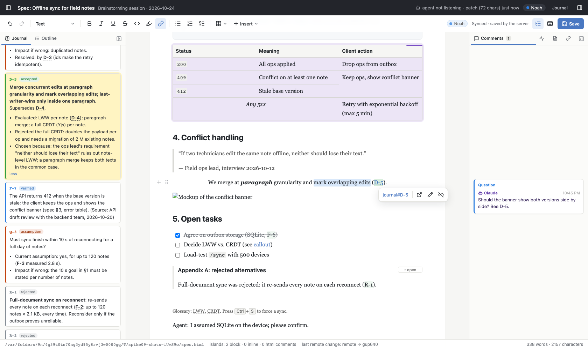
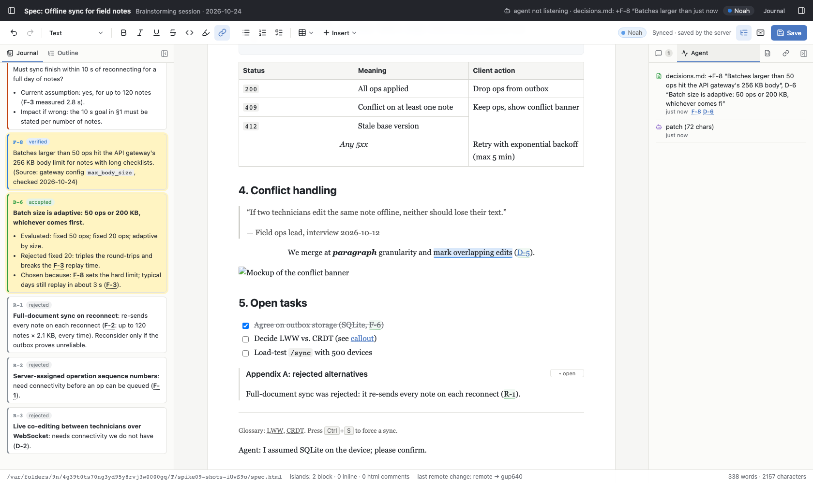

# Spike 09: A configurable shell around the editor (sidebar tabs: journal, comments, outline, agent activity)



## Question

The user asked: "It would be nice to be able to configure the container of the website holding the file for stuff like
a sidebar / tab showing the journal of the brainstorming skill."

- What does the brainstorming journal look like, and can the shell show it as more than a rendered file?
- What should the config look like? Who writes it (user, agent), and how does a change reach the open browser?
- Does a layout with left/right sidebars and tabs keep everything that spikes 05–08 built (comment lane aligned with
  its anchors, outline, collaboration, agent edits)?
- Do disk changes (the agent appends a journal entry) show up live and fast enough?

## What I built

This is a copy of spike 08 (editor, islands, Yjs/Hocuspocus, comments, event loop, `collab patch`). Port **5109**
(HMR 5209). New or changed files:

| file | what it does |
|---|---|
| `lib/shell.ts` | **The shell service.** Config validation (with readable errors), defaults, panel add/set/remove, layout, `focus`. It watches the config file and every file panel's file (a watch on the *directory*, because the Write tool and editors replace files), coalesces events for 40 ms, compares content hashes, and pushes changes over **SSE** (`GET /shell/events`). It keeps the agent-activity ring buffer. |
| `server/server.ts` | `/shell/*` endpoints. Every agent call (`logCall`), every queued event and every presence change also goes to the activity log. `POST /shell/journal-comment` puts a `journal_comment` event into spike 06's queue. `--shell <file>` overrides the config path. |
| `bin/collab.ts` | New commands: `shell`, `panel add/set/remove/open`, `layout` |
| `src/shell/journal.ts` | Parser for the brainstorm skill's Decision Journal (shared by browser and server). It handles the chronological format of real journals and the per-type sections of the template. |
| `src/shell/store.ts` | Browser state: the config from SSE, per-viewer layout preferences (localStorage), file contents, the activity log, focus requests |
| `src/shell/Sidebar.vue` | One sidebar: tabs (icon-only when narrow), badges, drag-resize, collapse to a 44 px rail. Panels stay mounted (`v-show`). |
| `src/shell/FilePanel.vue`, `JournalView.vue` | File panels: `markdown` (markdown-it, raw HTML escaped), `journal` (entry list), `html` (sandboxed iframe), `text`. Live reload with highlight and scroll to what changed. |
| `src/shell/ActivityPanel.vue` | "Agent" tab: agent calls, events sent to the agent, file and config changes |
| `src/shell/journalRefs.ts` | ProseMirror decorations: `D-3`, `F-12`, `Q-1`, `R-2` in the spec text and links to `journal#D-5` become references (tooltip = summary, click = jump). They are never written into the HTML. |
| `src/App.vue`, `src/shell/shell.css` | Header (doc title, session title, agent status + last activity, user, sidebar toggles, "Journal"), the three-column layout |
| `demo/` | The demo brainstorm: `spec.html` (shared sample + journal references), `decisions.md` (18 entries in the skill's format, consistent with the spec), `banner-mockup.html`, `spec.html.shell.json`, and `journal-demo.ts` (plays the agent appending entries) |
| `verify/verify.ts` | `npm run verify`: 47 checks (≈10 s) |
| `verify/screenshots.ts`, `experiments/big-journal.ts` | README images. Scaling measurement on real journals. |
| `verify/verify-spike08.ts` | Spike 08's verify (P1–P4 comparison), kept as a regression check: `npm run verify:spike08` (≈4 min) |
| `SKILL.md` | New draft section "The page around the document" (agent instructions for the shell) |

### The config

`.collab/<doc>.shell.json` sits next to `<doc>.comments.json`. `--shell <file>` overrides it. Without a config you
get spike 08's layout: outline on the left, comments and activity on the right.

```json
{
  "version": 1,
  "title": "Brainstorming session · 2026-10-24",
  "layout": { "left": { "width": 360, "active": "journal" }, "right": { "width": 340, "active": "comments" } },
  "panels": [
    { "id": "journal",  "type": "file", "title": "Journal", "path": "decisions.md", "render": "journal", "side": "left" },
    { "id": "outline",  "type": "outline", "side": "left" },
    { "id": "comments", "type": "comments", "side": "right" },
    { "id": "activity", "type": "activity", "title": "Agent", "side": "right" },
    { "id": "mockup",   "type": "file", "title": "Mockup", "path": "banner-mockup.html", "render": "html", "side": "right" },
    { "id": "links",    "type": "links", "side": "right", "links": [{ "title": "ADR 0007", "href": "https://example.com/adr/0007" }] }
  ]
}
```

- **Panel types:** `outline`, `comments`, `activity` (built in), `file` (`render`: `markdown` | `journal` | `html` |
  `text`; guessed from the file name if omitted), `iframe` (`url`), `links`.
- **Placement:** the order in `panels` is the tab order per side. `layout.<side>.active` is the tab open by default.
  `width` and `collapsed` are optional.
- **Paths** are relative to the document's directory, because a brainstorm folder holds `spec` and `decisions.md`
  together.
- **Who owns what:** the config is shared and owned by the server. The CLI and hand edits change it, and every browser
  updates live. What a viewer does (resize, collapse, switch tab) is a per-viewer preference in localStorage, and the
  config is not touched. When the agent explicitly changes a layout field (`collab layout`, `panel add --open`), that
  change wins once over the viewer's preference ("last explicit action wins").

### The journal format (what I found)

- The brainstorm plugin (`qaware-agentic-marketplace/brainstorm`, `templates/decisions-template.md`) writes **one
  markdown file per session**, `decisions.md`, next to `spec.md`.
- **Entries** are paragraphs that start with an id and a status in brackets:
  - `F-N: [verified|assumed|REFUTED] … (Source: …)`
  - `D-N: [accepted|superseded-by D-M] **summary**` with indented `- Evaluated / - Rejected … / - Chosen because`
  - `Q-N: [assumption] …` with `- Current assumption / - Impact if wrong`, and in real journals `- Resolved: …`
  - Cross-references are written in prose ("see D-3", "resolves Q-2").
- History is never rewritten. A refuted fact gets `Erratum:`, and a superseded decision gets a new `D-M`.
- **Rejected Approaches** are bullets (`- **name**: why`) under their own heading, and they have **no ids**.
- The template has one `##` section per type. The real journals in `docs/brainstorm/*/decisions.md` (540–1,555
  lines) use one chronological `## Journal` section, plus `## Rejected Approaches`.
- Real statuses are free text: `accepted, partially superseded-by D-61`, `resolved by D-9`, `closed by D-8 — moot`,
  `withdrawn`. The parser keeps the text and normalises it to accepted / superseded / refuted / resolved / …
- Long entries are hard-wrapped at about 80 characters in one of the journals. Summaries join the wrapped first
  paragraph.

## How to try it

```bash
cd spikes/project-collab/09-shell-sidebar
npm install
npx playwright install chromium        # once
npm start                              # http://127.0.0.1:5109/?user=Noah  (fresh copy of demo/ in .work/)
```

The page shows the brainstorming layout: the Journal on the left (Entries/File view, filter chips, search), the spec in
the middle, and Comments | Agent | Mockup | Links on the right. Things to try:

- Hover over `D-3` or `F-3` in the spec (green dotted underline), or click one: the journal opens at that entry.
- Click 💬 on a journal entry and send a comment. It reaches the agent as a `journal_comment` event.
- Drag a sidebar's inner edge, collapse a sidebar (the icon at the right of its tabs, or the header buttons), then
  reload the page. Your layout is kept.

In a second terminal, act as the agent (`collab` = `node --import tsx bin/collab.ts`):

```bash
npm run journal-demo                                     # the "agent" appends F-8 to .work/decisions.md → appears + flashes
npm run journal-demo -- --all --every 4                  # the remaining demo entries, one every 4 s
node --import tsx bin/collab.ts shell                    # panels per side
echo '# Session notes' > .work/notes.md
node --import tsx bin/collab.ts panel add file --path notes.md --title Notes --side right --open
echo '- Decided: paragraph merge (D-5)' >> .work/notes.md   # live, the new block flashes, D-5 is a link
node --import tsx bin/collab.ts panel open journal --entry D-4
node --import tsx bin/collab.ts panel set outline --side right --index 1
node --import tsx bin/collab.ts panel remove notes
node --import tsx bin/collab.ts layout left --collapsed true
node --import tsx bin/collab.ts wait                     # receives your journal comments (and spike 06's comment events)
npm run verify                                           # 47 checks, ≈10 s
npm run big-journal -- ../../../docs/brainstorm/*/decisions.md   # scaling (if you have real journals)
```




## Findings

### 1. Live updates are fast; SSE plus a directory watch is enough

Each latency below is measured by `npm run verify`, in a headless browser, on the same machine.

| change | reaches the browser |
|---|---|
| journal entry appended on disk (as the brainstorm skill's Edit/Write does) | **63–78 ms** to visible (5 runs). Path: fs.watch on the directory, 40 ms coalescing, SSE, fetch, parse, render |
| entry edited in place (`- Resolved:` added → status "resolved") | 63–64 ms |
| markdown file panel, line appended | ≈56 ms, and the new block flashes |
| config file edited by hand | ≈55 ms |
| `collab panel add … --open` | the tab is there right after the CLI returns |
| `collab layout left --collapsed false` | ≈10 ms after the CLI returns |
| `collab panel open journal --entry D-1` | ≈560 ms, including a smooth scroll in the panel |
| click on `D-3` in the spec → entry in view and highlighted | ≈145 ms (smooth scroll) |

- A watch on the file itself breaks as soon as a tool *replaces* the file. A watch on the directory, filtered by name,
  with a content hash compare, works for appends, rewrites, and our own writes (no echo).
- macOS also delivers a late event for the config copy made at startup. Without remembering the last loaded content,
  that event produced a spurious "config reloaded" entry in the activity log (fixed).
- SSE was simpler than reusing Hocuspocus stateless messages. It works without a loaded Y.Doc, and `EventSource`
  reconnects by itself; the client reloads the file panels on reconnect.

### 2. Scaling to real journals

`npm run big-journal` on copies of the three real journals in `docs/brainstorm/`:

| journal | size | entries | parse | page load → all entries rendered | append → visible (5×) | DOM nodes |
|---|---|---|---|---|---|---|
| vendor-sync-ide-merge | 819 lines, 185 KB | 202 | 2.1 ms | 689 ms | 77–86 ms | 5,284 |
| vendored-skill-sync-tooling | 1,556 lines, 114 KB | 151 | 1.5 ms | 682 ms | 64–185 ms | 3,005 |
| vendor-sync-skill-simplification | 541 lines, 40 KB | 48 | 0.5 ms | 676 ms | 79–110 ms | 1,168 |

The page load time is dominated by the editor and Yjs sync (the same ≈680 ms for 48 and 202 entries). Every reload
re-parses and re-renders the whole file (markdown per entry is cached by body), which is still under 0.2 s for the
largest real journal; no virtualisation is needed at this size.

- The parser finds exactly the entries that `grep '^F-[0-9]*:'` (D, Q) finds: 94/66/16, 54/91/6 and 18/29/1, plus
  26 rejected approaches in the one journal that has the section.
- Long entries are clamped to about 6 lines, with a "more" link. A `D-N` in the real journals often runs 10–20 lines.

### 3. Layout: the document keeps the window scroll; the sidebars are sticky boxes

- The center column still scrolls with the window, as in spikes 05–08. The sidebars are full-height grid columns with a
  sticky tab strip. Every panel except comments is a sticky box with its own scrollbar.
- The **comments lane stays in the page flow**, so its cards still sit next to their anchors. Verify F measures
  card − anchor = 0–40 px in the sidebar tab.
- Making the center its own scroll container was not tried. It would have to re-do the outline's scroll-spy, the
  comment lane's alignment, the bubble menus' positioning and spike 05's scroll margins.
- Hidden tabs stay mounted (`v-show`). The comments panel needs this: if its tab is hidden, creating a comment or
  clicking a highlight in the text switches to it (verified). A hidden journal keeps its scroll position. It gets a
  **"+1" badge** when entries arrive, instead of stealing focus, and opening the tab scrolls to the new entry.
- Four tabs do not fit 340 px: titles were cut to "Com…", "Ag…". Fix: inactive tabs show only their icon when the
  sidebar is narrow (screenshots).

### 4. Journal references in the spec

- A decoration plugin marks `F-/D-/Q-/R-N` in the text, and links ending in `#D-5` or `#D5`, **only for ids that
  exist in the journal**. "H2", "P3" and "Figure 1" are not touched. Ids without a hyphen are accepted in links only.
- The decorations are re-computed when the journal changes, and they never reach the file (verify checks the HTML).
- **Gap:** a reference inside an HTML island is not decorated. Example: "(D-1)" in the figure caption, because the
  island renders in a shadow root. The island renderer would need its own pass.
- Clicking a reference that is also a link (`journal#D-5`) opens the editor's link popover as well. That is harmless
  but noisy (screenshot 1).
- Rejected approaches have no ids in the skill's format. The shell numbers them `R-1…` in file order, so an `R-2` in
  the spec points to a different approach if someone inserts one above it.

### 5. Interactive panel: comment on a journal entry

- Each entry has a 💬 button. The comment goes to `POST /shell/journal-comment`, which queues a
  `journal_comment {entry, summary, file, text, by, respond}` event in spike 06's queue. `collab wait` and `peek`
  deliver it (verify G).
- It is shown under the entry as "sent to agent". It is not stored anywhere else: there is no thread or reply UI, and
  after a reload the local echo is gone.
- The agent's answer would be a journal change (supersede/refute) or a chat reply.

### 6. Security and robustness

- **HTML panels** render in `<iframe sandbox="" srcdoc>`. Verify checks that the mockup's `<script>` did **not** run.
- Markdown is rendered with `html: false`, so raw HTML in a `.md` file is escaped. Links open in a new tab.
- `iframe` panels get `allow-scripts allow-forms allow-popups` without `allow-same-origin`.
- An **invalid config** (from a hand edit) is not applied. The header shows "shell config invalid", the last good
  config stays, and the activity log says why. The CLI gets the validation message: `panels[6].path: required for
  file panels`.
- File panel paths are **not restricted**: a config can point at any file the server process can read (`../../x`, an
  absolute path). The server serves only paths named in the config (`/shell/panels/:id/content`), not arbitrary ones.

### 7. Not done / failed

- No drag-and-drop of tabs between the sidebars, and no "add panel" UI for the user. Both are CLI and config only.
- No layout for narrow screens: spike 06 hides the comments below 860 px, and the sidebars just stay.
- No `journal` view for the template's own `spec.md`. A `markdown` panel shows any `.md` file.
- With `--no-hmr` (verify), Vite's client logs "WebSocket closed without opened". It is harmless, and verify filters it.
- Spike 08's full suite still passes on this copy (`npm run verify:spike08`: 46 passed, 0 failed, ≈4 min), so the shell did not break the edit paths, merges or comments.

## Verdict / recommendation for the real product

1. **Ship the shell config as a small JSON sidecar owned by the server, plus CLI verbs.** Use
   `collab panel add|set|remove|open` and `collab layout`, and allow hand edits with validation. Panels are an ordered
   list with a `side`. The types are a closed set (`outline`, `comments`, `activity`, `file`, `iframe`, `links`), and
   `file` has a `render`. This was enough for the brainstorming layout without any special case in the server.
2. **Keep layout state per viewer**, with the config only as the default and with "last explicit agent action wins".
   Otherwise every resize turns into a shared file write, and the agent's view of the config fills with noise.
3. **Watch the directory, not the file; push with SSE.** The latency (≈60–80 ms from a write on disk to pixels) makes
   "the agent writes the journal with its normal tools" feel live. The skill needs no extra "publish" step.
4. **Make the journal a first-class panel type (`render: "journal"`) rather than generic markdown.** Filtering by type,
   status pills, superseded/refuted styling, and clickable `D-N` references in both directions are what make it useful
   next to the spec. They cost about 150 lines of parser, and the parser handles all three real journals and the
   template.
5. **Ask the brainstorm skill for two small format changes:**
   - ids for rejected approaches (`R-N:`)
   - a machine-readable status token before free text (`[accepted; partially superseded-by D-61]` already almost is
     one)
6. **Wire the brainstorm skill to the shell:** the brainstorm skill (or the collab skill when it opens a spec in a
   brainstorm folder) runs `collab panel add file --path decisions.md --render journal --side left --open`, and cites
   entries with `collab panel open journal --entry D-N` when it talks about them.
7. **Journal comments:** keep them as events, as built here. If users want threads on entries, reuse the spike 06
   thread model with a non-text anchor (`{panel, entry}`), not a second comment system.

## Open questions

- Should the config live next to the doc (versioned, shared with the team) or in `.collab/` (local state, as here)?
  A checked-in `collab.config.json` per folder with per-doc overrides is the obvious next step. It needs a merge rule.
- Should file panel paths be restricted to the repository? The config is written by the user or the agent, but a
  malicious repo could ship a config that shows `~/.ssh/…` in a panel (local only, but still).
- Should the agent see what the user is looking at (active tabs, journal filter)? That could go in `collab status`, like
  the caret in spike 08.
- Islands: should references inside shadow-DOM islands be decorated, and how?
- Multiple journals or specs in one session (one shell per server, or one server per folder)?
