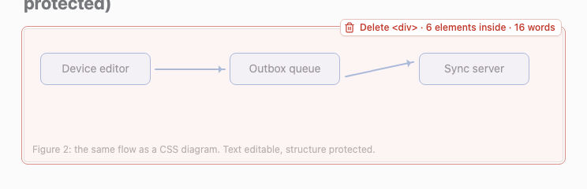
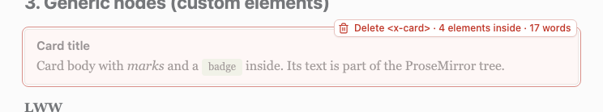
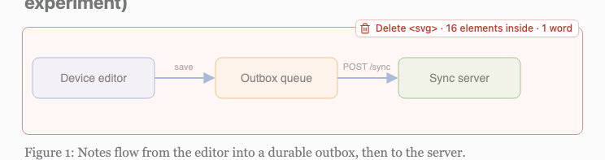
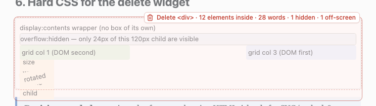
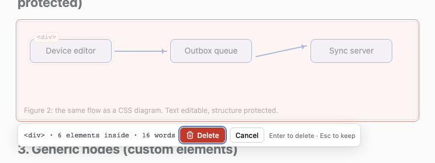
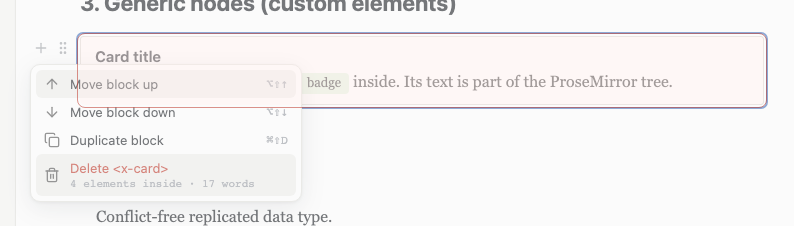

# Spike 10: generic editable nodes for unknown elements vs islands — round 2: protect them like table cells



| hover the card's padding: `<x-card>` with 4 elements inside | SVG island: one overlay over the host, `<g>`/`<line>`/`<defs>` no longer need boxes | hard CSS: the summary says what the overlay cannot show ("1 hidden · 1 off-screen") |
|---|---|---|
|  |  |  |

| keyboard path: Esc selects the element, Backspace arms the confirm bar, Enter deletes | the block-menu alternative: the delete item carries the summary and previews on hover |
|---|---|
|  |  |

Round 1's widget (a box per descendant + a red badge) is kept as `screenshot-v1-widget-*.png`, its matrix as `verify/matrix-v1.md` / `verify/matrix-v1.expected.json`. `screenshot-full.png` is the whole try-out document after `npm run verify`.

## Question

Spike 04 turns every element the schema doesn't know into an **island** (exact source in one attribute, shadow-root render, text-only leaves editable as plain text). Round 1 built the alternative — a **generic node** per unknown element (tag + all attributes, editable children, text in ProseMirror's tree) — and battle-tested Tiptap's interactions against both. It found that free generic nodes (and spike 04's `Container`) are structurally fragile in four ways (Delete at the end pulls the next block in, a selection across the edge deletes the wrapper, `/bullet` lifts the text out, Enter duplicates the element with its attributes) and protected them with a transaction *lock* that rejected whole transactions.

Round 2 asks, after the user's decisions:

1. **Simple rule, no per-element policy**: SVG/MathML/canvas, embeds, forms/controls, scripts/styles/templates, HTML comments and tables with `<caption>` are islands; **everything else is a free generic node**. No `data-edit`, no selector rules in the default configuration. Does that hold up on the samples, and what happens to a positioned diagram box in *free* mode (round 1 only ran it locked)?
2. Can generic nodes and `Container` be protected **the way Tiptap's table protects its cells** — `isolating`, selection clamping, emptying instead of removing, own paste handling, repair in `appendTransaction` — instead of rejecting transactions? What does `isolating` really buy, and what does it cost?
3. Enter inside a generic element: `block+` content like a table cell (variant a) or keep the text-block shape and handle Enter (variant b)? Measured on fidelity.
4. A delete preview UI that is clearly better and calmer than round 1's boxes-and-badge.

## What I built

Copy of spike 07 (spike 05's editor UI + Yjs/Hocuspocus collaboration + agent CLI). Port **5110** (HMR 5210). Round 1's files, as they stand after round 2:

| file | what it does |
|---|---|
| `src/generic/policy.ts` | **Round 2 default: everything free.** `policy.default = 'free'`, `rules = []`. `ALWAYS_ISLAND` (svg, math, canvas, iframe, video, script, style, form controls, …) wins over everything; comments and tables with `<caption>` are islands in `classify.ts`. Kept as switches: `data-edit="locked\|island"` per element (the matrix's comparison columns use it), `--mode locked\|islands\|rules` / `?mode=` (`rules` = round 1's default), `policy.isolating` (`?isolating=0`), `policy.textblocks = 'block'` (`?shape=block`, `--shape block`: Enter variant a). |
| `src/islands/classify.ts` | Spike 04's rule with three outcomes. Round 2: a known wrapper (`div`, `section`, …) that holds **only text/phrasing content** (`<div class="node">Device editor</div>`) becomes a generic **textblock** instead of a `Container` with a `<p>` inside — the diagram box's children round-trip without wrapping. A wrapper with flow children stays spike 04's `Container`. |
| `src/generic/nodes.ts` | `genericBlock` (`block+`, **isolating**, `allowGapCursor: false`), `genericTextBlock` (`inline*`, **not** isolating — measured, see §R2.4), `genericInline`. Attributes: `tag`, `attrs` (verbatim), `mode`, `marks`. |
| `src/generic/protect.ts` | **New: the protection** (§R2.2): decorations, keymap (Backspace/Delete at element edges, Enter inside elements, Escape = select the element, Backspace/Delete on a selected element = confirm), `appendTransaction` (selection clamping like `normalizeSelection`, duplicate-`id` repair like `fixTables`), `handlePaste` (flatten block HTML into a textblock), `handleTextInput` + `cut` (delete text only when the default would drop an element). Every intervention is logged to `window.__guardLog` as `protect: …`. |
| `src/generic/guards.ts` | Round 1's `StructureLock` (fingerprint `filterTransaction`), now only for `mode: locked` (the comparison column). |
| `src/generic/deleteWidget.ts`, `src/generic.css` | **New delete UI** (§R2.6): trash button → union overlay + summary; keyboard confirm bar; `previewOf()`; round 1's `collectBoxes()` kept as the measurement API. |
| `src/editor/commands.ts` | `turnIntoAllowed()`: "turn into" (paragraph/heading/list/quote/code) is refused inside a generic textblock with a toast, on every surface (toolbar, slash menu, block menu, shortcuts). `deleteSummary()` for the block menu. |
| `src/ui/BlockHandle.vue` | The block menu's delete item shows "Delete `<x-card>` · 4 elements inside · 17 words" and previews on hover. |
| `src/extensions.ts` | `Container` is **isolating** + `allowGapCursor: false` (same protection as a generic block); `Protect` registered after StarterKit and before the UI extensions (keymap order matters: the slash menu must see Enter first, Tiptap's `Keymap` last). |
| `samples/battle.html` | The try-out document, now with **no** `data-edit="locked"`: the diagram box and the hard-CSS section are free. The island card (section 4) keeps `data-edit="island"` for the side-by-side comparison. |
| `verify/matrix.ts` | **43 rows × 6 kinds**, + 10 rows × 2 kinds with `?isolating=0`, + 2 collaboration rows = 290 cells asserted against `verify/matrix.expected.json`. Writes `verify/matrix.md` (table, isolating table, every observation) and **`verify/matrix-diff.md`** (cell-by-cell v1 → v2 from `matrix-v1.expected.json`). |
| `verify/widget.ts` | The delete UI against the same four cases as round 1 + keyboard path + block menu; screenshots. |
| `verify/isolating-probe.ts` | `npm run probe:isolating`: what `isolating` changes at Transform level and for ProseMirror commands invoked without the keymap. |
| `verify/verify.ts` | `npm run verify` = matrix + widget + the collaboration save path (server-side seeding, typing in the free diagram box, Enter in a positioned node, agent `replace-text` in a `<dd>`, file on disk, fixed point). |
| `fidelity/fidelity.ts` | `npm run fidelity`: presets `islands`, `rules` (round 1 default), **`free`** (round 2 default), `free+block` (Enter variant a), `locked`; new column "`<p>` added". |

## How to try it

```bash
cd spikes/project-collab/10-generic-nodes
npm install
npx playwright install chromium   # once
npm start                         # http://127.0.0.1:5110/  — round 2 default: everything free, protected
npm start -- --mode islands       # spike 04 behaviour;  --mode locked (round 1's lock), --mode rules (round 1's default)
npm start -- --shape block        # Enter variant (a): text-bearing elements get block+ content
npm run verify                    # matrix + widget + collab save path; exits 0/1; refreshes the screenshots
npm run matrix -- --record        # re-record the matrix after a change (review the diff!)
npm run probe:isolating           # what isolating changes (quoted in §R2.4)
npm run fidelity                  # fidelity/report.md
```

In the UI (`http://127.0.0.1:5110/?user=Noah`; per-tab switches `?isolating=0`, `?shape=block`, `?mode=…`, `?collab=0`):
- Hover any element: a `<tag>` chip and, top-right, a small grey **trash**. Hover the trash: the element gets a soft overlay, the page around it fades, the button reads "Delete `<x-card>` · 4 elements inside · 17 words". Click = delete, ⌘Z = undo.
- Click into a diagram node, press **Esc**: the node is selected (blue outline); **Esc** again selects the diagram box. **Backspace** now shows the confirm bar ("Delete · Cancel · Enter to delete · Esc to keep") instead of deleting.
- Block handle (⋮ grip) → menu → "Delete `<div>` · 6 elements inside · 16 words" (preview on hover).
- Type in the free diagram box: Enter inside a node inserts a line break (the node is absolutely positioned), Delete at the end of the caption does nothing, a selection dragged from above into the box stops at its edge.
- `x-card`: Enter in the middle of the note splits it (the second half has no `id`), Enter at the end makes a paragraph after it, `/h2` is refused with a toast, `/table` inserts a table into the card, pasting `<p>…</p><ul>…</ul>` into the note gives text with line breaks, Backspace at the start of the note does nothing, a second Backspace in an *emptied* note removes it.
- Agent: `npm run agent -- replace-text 'Last writer wins.' 'Last writer wins (LWW).'`, `list`, `set-block <bid> '<x-card>…</x-card>'` as in round 1.

## Round 2

### R2.1 What changed

| user decision | implementation | measured |
|---|---|---|
| simple rule, everything free | `policy.default = 'free'`, no rules; the per-element attribute and `--mode` stay as comparison switches | the matrix's `free` column uses a plain `<x-card>` (no attribute); battle.html has no `data-edit="locked"` any more; fidelity "`<p>` added" for battle.html: islands 11, rules 7, **free 1** |
| text-only known wrappers | `<div>text</div>` → generic textblock (was `Container` + `<p>`) | the diagram box and the hard-CSS children keep their exact shape; `verify.ts` checks the file has no `<div class="node"><p>` |
| protect like table cells, not reject | `protect.ts` (§R2.2) replaces the lock as the default; the lock is `--mode locked` | 6 cells went from destructive-but-paragraph-like to protected, 2 from broken to protected (§R2.3) |
| isolating + measure the trade-off | `isolating` on blocks/containers, `?isolating=0` pass in the matrix, `probe:isolating` | §R2.4: isolating stops command-level lifts/joins; it does nothing at Transform level; on a textblock it breaks Shift+Enter; its gap-cursor stops are removed with `allowGapCursor: false` |
| Enter must not duplicate the element | variant (b): split without `id` / paragraph after / `<br>` in positioned elements; variant (a) measured as `--shape block` | §R2.5: variant (a) costs 16 wrapped elements in battle.html (4 in edge-structure, 2 in spec); (b) costs nothing |
| turn-into must not remove the element | command registry refuses with a toast | `/h2`, `/bullet` inside `<x-note>`: structure intact (round 1: `<x-note>` replaced by `<h2>` / lifted out of the card) |
| free diagram box | battle.html section 2 is free | §R2.6 |
| delete UI redesign | `deleteWidget.ts` v2 + block menu alternative | §R2.7 |

### R2.2 The protection set, piece by piece (what `tableEditing()` does for cells → what `protect.ts` does for elements)

| prosemirror-tables | generic nodes / `Container` (round 2) | catches (matrix row) |
|---|---|---|
| `isolating: true` on cell + table specs | `isolating: true` on `genericBlock` and `Container` (**not** on `genericTextBlock`, see R2.4) | `lift`, `joinBackward`/`joinForward` from any code path stop at the block's edge (`probe:isolating`) |
| `handleKeyDown`: Backspace/Delete on a `CellSelection` = `deleteCellSelection` (empties) | keymap: **Backspace at the start of a generic textblock, or of the first direct child of a protected block, does nothing**; Delete at the end of a generic textblock / last child does nothing; a second Backspace in an *emptied* non-only element removes it (that is the one way the keyboard removes an element: it is already empty) | `bs-start`, `bs-first`, `del-end`, `del-first-end` |
| `normalizeSelection` / `isTextSelectionAcrossCells` in `appendTransaction` | **selection clamping**: a `TextSelection` whose anchor is inside a block the head is not in is clamped to that block's content edge (innermost such block, like a cell); a head that entered a block the anchor is outside of is clamped to just outside it (outermost). `AllSelection` (⌘A) and `NodeSelection` untouched | `cross-del`, `cross-del-out`; select-all + Backspace still clears the document like a paragraph does |
| `deleteCellSelection` empties cells, never removes them | **emptying delete**: Backspace / Delete / typing / cut over a text selection that *would* remove an element (`defaultDeleteDropsUnits` runs `deleteSelection` on a scratch transaction and counts elements) deletes the selected text per textblock instead | `inner-del`: `x-card(x-title, x-note)` both emptied, elements kept |
| `handlePaste` (cells into cells) | paste of block HTML into a generic textblock is flattened to inline content with `<br>` between blocks (ProseMirror would split the element and push the blocks into its parent) | `paste-html` |
| `fixTables` in `appendTransaction` | **repair**: duplicate `id`s among generic nodes *and* known nodes (`htmlAttrs.id`) are dropped from the later copies. Found while measuring: Tiptap's `splitBlock` honours `keepOnSplit: false` only when Enter is pressed at the *end* of a block; in the middle every attribute is copied, so `<p id="t">` / a heading with an anchor ends up twice | `enter` (all kinds now `dupId=no`) |
| — | Enter inside a generic textblock: at the end → paragraph after the element; at the start → paragraph before; in the middle → split with `id` dropped from the second half; inside an absolutely/fixed positioned element → `<br>` (a split would overlay a copy at the same coordinates). Enter in an empty paragraph inside a protected block → new paragraph (ProseMirror's `liftEmptyBlock` would lift it out or **split the container in two**) | `enter`, `enter-end`; `verify.ts` Enter in a diagram node |
| `CellSelection` + explicit commands | **Escape** selects the enclosing element (`NodeSelection`), again its parent; **Backspace/Delete on a selected element arm the delete UI** (confirm bar) instead of deleting. Only the delete UI, the block menu and the agent remove elements | `nodesel-del`, `delete-widget` |
| — | "turn into" refused in the command registry (toast + log) | `slash-h2`, `slash-list` |
| `allowGapCursor` | `allowGapCursor: false` on protected blocks (see R2.4) | `arrow-in`, `arrow-out`, `arrow-down-out` |

What the protection deliberately does **not** do: it never rejects a transaction. Remote (Yjs) changes, the agent's ops and `setContent` go through untouched; a *programmatic* `tr.deleteRange()` across an element edge still removes the element (R2.4) — the protection is for the user's editing commands.

### R2.3 The interaction matrix, v1 → v2

`npm run verify` asserts all 290 cells; `verify/matrix.md` has every observation, `verify/matrix-diff.md` the cell-by-cell comparison. Columns: `paragraph` baseline · `container` = spike 04 `Container` (grid column) · `free` = `<x-card><x-title><x-note>` **with no attribute** (round 2 default) · `locked` = round 1's lock (`data-edit="locked"`) · `island` (`data-edit="island"`) · `svgText` = the SVG-as-nodes experiment (unchanged, reference only). `ok` = like the paragraph baseline; **guarded** = the protection kept the structure (nothing happened, or only text changed); **broken** = something unwanted. Round 2 treats `container` and `free` as protected kinds, so "nothing happened, tree intact" counts as guarded for them too (in round 1 they were unprotected, so the same outcome would have been broken).

Cells whose verdict changed between the rounds (`verify/matrix-diff.md`): **2 fixed** (broken → guarded: Delete at the end of a container / free node no longer pulls the next block in), **1 new capability** (delete UI now covers containers), **6 now protected** (ok → guarded: the interaction used to "work" the way a paragraph works, by destroying the element — Backspace at the start of `<x-note>` merged it into `<x-title>`; a selection from "Before" into the card deleted the card; pasting a list split the note; `/h2` replaced it; `/bullet` lifted it out), **0 worse**; the other 21 changed cells have the same verdict with a richer observation (the `protect:` log line, `dupId=`); 165 cells are identical. 30 new cells from the five round-2 rows.

| interaction | paragraph | container | free | locked | island | v1 → v2 |
|---|---|---|---|---|---|---|
| typing in the middle | ok | ok | ok | ok | ok | — |
| Backspace at start | ok | ok ¹ | **guarded** ² | **guarded** | **guarded** | free: ok → guarded |
| Backspace in the middle / at end, Delete at start / in the middle | ok | ok | ok | ok | ok | — |
| Delete at end | ok | **guarded** ³ | **guarded** ³ | **guarded** | **guarded** | container, free: **broken → guarded** |
| selection from "Before" into the target, Backspace | ok | **guarded** ⁴ | **guarded** ⁴ | **guarded** ⁴ | **guarded** | container, free: ok → guarded |
| *new* selection from the target into "After", Backspace | ok | **guarded** ⁴ | **guarded** ⁴ | **guarded** | **guarded** | |
| *new* Backspace at the start of the element's first child | n/a | **guarded** ⁵ | **guarded** ⁵ | **guarded** | **guarded** | |
| *new* Delete at the end of the first child (would pull the target in) | n/a | ok ¹ | **guarded** ⁵ | **guarded** | **guarded** | |
| *new* select first child → end of target (inside), Backspace | n/a | ok ⁶ | ok ⁶ | ok ⁶ | ok | |
| Enter in the middle | ok ⁷ | ok ⁷ | ok ⁸ | **guarded** | **guarded** | all: duplicate `id` now repaired |
| *new* Enter at the end, type "new" | ok | ok | ok ⁹ | **guarded** | **broken** ¹⁰ | |
| Shift+Enter in the middle | ok | ok | ok | ok | **guarded** | — (ok again after taking `isolating` off textblocks, R2.4) |
| Tab | **broken** | **broken** | **broken** | **broken** | **broken** | — (Tiptap binds Tab only in lists/code) |
| select all, then type / Backspace | ok | ok | ok | **guarded** ¹¹ | **guarded** | — |
| double-click, triple-click | ok | ok | ok | ok | ok | — |
| → into the target, → out, ↓ out | ok | ok | ok | ok | **broken** ¹² | — (would be broken with gap cursors, R2.4) |
| cut/paste within, copy out, copy block out, paste text in | ok | ok | ok | ok | ok | — |
| paste external HTML (p + list) in the middle | ok | ok ¹³ | **guarded** ¹³ | **guarded** | n/a | free: ok → guarded |
| drag handle: drag the block below "After" | ok | ok | ok | ok | ok | — |
| undo ×2, redo ×2 | ok | ok | ok | ok | **broken** ¹⁴ | — |
| IME composition | ok | ok | ok | ok | ok | — |
| slash menu: /h2, /bullet | ok | ok | **guarded** ¹⁵ | **guarded** | **guarded** | free: ok → guarded |
| slash menu: /table, /callout | ok | ok | ok ¹⁶ | **guarded** | **guarded** | — |
| ⌘B / ⌘U | ok | ok | ok | ok / **guarded** | **guarded** | — |
| text bubble menu | ok | ok | ok | ok | **broken** | — |
| drag handle grip selects the block | ok | ok | ok | ok | ok | — |
| emptied element remains, clickable, saved | ok | ok | ok | ok | ok | — |
| delete UI: hover → trash → overlay + summary → click | n/a | ok | ok ¹⁷ | ok | ok | container: n/a → ok |
| *new* keyboard: grip selects the block, Backspace → confirm bar → Enter | ok ¹⁸ | ok | ok | ok | ok | |
| two clients type in the same node | ok | ok | ok | ok | **broken** ¹⁹ | — |
| agent replace-text while the user types | ok | ok | ok | ok | **guarded** ¹⁹ | — |

Notes (observation strings in `verify/matrix.md`; round 1's in `verify/matrix-v1.md`):
1. Plain blocks inside a container keep ProseMirror's behaviour: the `<p>` joins into the `<h3>` above it (Backspace at start), the `<h3>` absorbs the `<p>` (Delete at its end). Only the *element's* edge and element textblocks are protected.
2. `<x-note>` no longer merges into `<x-title>` (round 1: the `<x-note>` element silently disappeared). An emptied `<x-note>` is removed by a second Backspace (`protect: removed the emptied <x-note>`).
3. The next block is no longer pulled in. In round 1 "After" moved inside the card and the grid's right column merged into the left.
4. The selection is clamped at the element's edge (`protect: selection clamped to before <x-card> (it started outside)`); Backspace then deletes "ore" only. From inside to outside: clamped to the end of the innermost block the anchor is in — the left grid *column*, not the whole grid.
5. First child: `protect: Backspace at the start of the first block inside <div> does nothing (no lift, no join out)` — without it ProseMirror lifts the `<h3>` / `<x-title>` out of the element (`probe:isolating`: `p,x-title,x-card(x-note),p`).
6. The selected text goes, the elements stay: `x-card(x-title, x-note)` both empty (`units=3` before and after). In the container the `<h3>` and `<p>` join into one empty `<h3>` (plain blocks).
7. Measured round 2: Enter in the middle of `<p id="t">` duplicated the id in round 1 (Tiptap's `keepOnSplit` only applies at the end of a block). The repair drops it from the second half: `protect: dropped duplicate id="t" from a second <paragraph>`.
8. `x-card(x-title, x-note, x-note)`, the second `<x-note>` without `id` (`dupId=no`). Splitting an element in two is what Enter means in a text block; the alternative (`<br>`) is used for positioned elements only (R2.6).
9. A `<p>` after the `<x-note>`, inside the card (`x-card(x-title, x-note, p)`): the element stays whole, the new paragraph is where the caret is.
10. Island leaf: Enter is ignored by the leaf, focus returns to ProseMirror with the island node-selected, and the typed "new" **replaces the island** — a spike 04 island problem, visible for the first time because the row is new.
11. Round 1's lock rejects the whole-document replacement, so nothing happens. Round 2's free default clears the document like a paragraph does (the user asked for everything to go).
12. Arrow keys cannot enter an island (spike 04, round 1 note 12).
13. Container (block+): the list goes inside the column, next to the paragraph — right for a `<div>`. Generic textblock: flattened to `Alpha Ext bold⏎item onebeta gamma` inside the `<x-note>` (`protect: pasted 2 blocks as text inside <x-note>`); round 1 split the note and put a `<ul>` into the card.
14. Island: ⌘Z works, redo needs the toolbar (round 1 note 18).
15. `protect: turn-into refused inside <x-note>` + toast "`<x-note>` is an element of its own — it can't be turned into another block. Edit its text, or delete it." The slash menu still lists the commands; they refuse when run.
16. `/table` and `/callout` insert *after* the note, inside the card (`x-card(x-title, x-note, table(…))`): the card's `block+` allows it, nothing is lost.
17. Hovering the note's text targets the **innermost** element (`<x-note>`); hovering the card's padding targets the card (round 1 always took the outermost).
18. For a plain paragraph the grip selects it and Backspace deletes it directly (`confirm=none`): paragraphs are not elements.
19. Round 1 notes 25–27: per-character merge in generic nodes, last-writer-wins per island, the agent's soft lock on islands.

Still broken, honestly: Tab leaves the editor (all kinds); islands cannot be entered by arrow keys, lose on undo/redo, bubble menu and concurrent typing, and Enter-then-type in a leaf replaces the island; `svgText` remains unusable (round 1 §2). Nothing in the `free` or `container` column is broken any more except Tab.

### R2.4 The `isolating` trade-off, measured

Three measurements:

1. **The matrix with `?isolating=0`** (10 rows × container/free, bottom table of `verify/matrix.md`): every cell has the **same verdict** with and without `isolating`. The keymap and the selection clamping do the work for the interactions a user can perform.
2. **`npm run probe:isolating`** — what differs:

   | operation (no keymap involved) | `isolating: true` | `isolating: false` |
   |---|---|---|
   | `tr.deleteRange(Bef\|ore … Alpha \|beta)` across the card's edge | `p,p "Befbeta gamma\|After"` — **card removed** | same |
   | `tr.deleteRange(Alpha \|beta … Aft\|er)` | `x-card(x-title, x-note "Alpha er")` — "After" merged *into* the note | same |
   | `tr.replaceRange(…)` across the edge | card removed | same |
   | `commands.joinForward()` at the end of the target | nothing | `x-card(x-title, x-note, p)` — "After" pulled in |
   | `commands.joinBackward()` at the start of the first child | nothing | `p,x-title,x-card(x-note),p` — `<x-title>` **lifted out** of the card; grid: `div(h3, div(p), div(h3,p))` |
   | `commands.lift()` on the target | nothing | `x-card(x-title),x-note` — note lifted out; grid: `div(div(h3), p, div(h3,p))` |
   | `joinBackward` / `liftListItem` at the first item of a list inside the card | item lifted into the card (`x-card(p, ul(li(p)))`) | same |

   So `isolating` is **not** a Transform-level guarantee (ProseMirror's `deleteRange`/`replaceRange` only use it to decide how far to *expand* a deletion, not to refuse crossing it) — it is a guard for the *commands* (`joinBackward`, `joinForward`, `lift`, `findCutBefore/After`, `liftTarget`), i.e. every code path that is not our keymap: other extensions, chains, input rules, a future "join" button.
3. **Costs found**: (a) an isolating node makes every position next to its children a **gap-cursor stop** (prosemirror-gapcursor's `closedBefore/closedAfter`): → from "Before" first landed *inside* the card before `<x-title>` (`caret=x-card@0`), ↓ from the note landed after it (`x-card@24`) — the first v2 run had `arrow-in`/`arrow-out`/`arrow-down-out` broken for container, free and locked. `allowGapCursor: false` on the protected blocks removes the stops (the gap cursor's one use, "a paragraph between two child elements", is covered by Enter at the start/end of a child). (b) **`isolating` on a textblock breaks inline insertion**: `can().setHardBreak()` is false, Shift+Enter does nothing, `insertContent` of an image would fail too (the replace fitter will not open an isolating textblock for an inline slice). Round 2 therefore puts `isolating` on `genericBlock` and `Container` only; a generic textblock gets its edge protection from the keymap and, when nested, from the enclosing block's edge (the lifts above stop at the *block*, whether or not the textblock is isolating). (c) The known trade-off "Backspace at the start of the first child no longer merges up" is **not** caused by `isolating` — without it ProseMirror does not merge up either, it *lifts the child out of the element* (table above). The narrow keymap no-op is the better behaviour in both cases, so the question "isolating or a narrower keymap?" has a measured answer: **both** — the keymap for the keys (it is what users see), `isolating` on blocks for everything else, with `allowGapCursor: false`; never on textblocks.

### R2.5 Enter: variant (a) `block+` vs variant (b) text-block shape + handler

| | (a) `block+` like a table cell (`--shape block`, `?shape=block`) | (b) keep `inline*`, handle Enter (default) |
|---|---|---|
| Enter in the middle | splits the inner `<p>`, the element stays one | splits the element, `id` dropped from the second half (note 8) |
| Enter at the end | new `<p>` inside the element | new `<p>` after the element, inside its parent (note 9) |
| positioned element | new `<p>` inside the node (taller node) | `<br>` |
| fidelity (`npm run fidelity`, "`<p>` added" = block-level elements whose direct text got a `<p>` around it; list items / cells excluded) | battle.html **17** wrapped (`<div.node>` ×3, `<div.caption>`, `<dt>`/`<dd>` ×4, `<figcaption>`, the hard-CSS divs, `<x-agent-note>`) + `<x-title>`/`<x-note>` ×2 (reported in the "changed" column: 4 elements changed vs 0); edge-structure **5** (`<dt>`, `<dd>`, `<figcaption>`, …); spec.html **3** (`<figcaption>`, `<x-agent-note>`) | battle.html **1** (the callout, a known editor node), edge-structure 1 (`<blockquote>`, Tiptap's own), spec.html 1 — i.e. **zero** cost from generic nodes |
| rendering | every text-bearing custom element gets paragraph margins inside (`x-note > p`) — the agent's CSS did not plan for that | unchanged |
| Backspace at the start of the inner `<p>` | joins into the previous `<p>` inside the element (cell behaviour) | element edge: nothing |

**Decision: (b).** Variant (a) is what tables do, but a table cell is a container by definition; `<x-note>`, `<dd>`, `<figcaption>`, `<div class="node">` are text blocks by the author's intent, and (a) rewrites 16 of them in the try-out document and changes their rendering. (b) keeps the file byte-stable (modulo whitespace) and gives Enter a defined meaning per situation. The one thing (a) does better — "Enter never makes a second element" — (b) gets for positioned elements with the `<br>` rule and for everything else with the dropped `id` plus the repair.

### R2.6 The free diagram box (`samples/battle.html` section 2, `verify/verify.ts`)

Round 1 ran it locked. Free, with round 2's rules it becomes `container(div.diagram-box)` holding six generic **textblocks** (`<div class="node">`, `<div class="arrow">` ×2 empty, `<div class="caption">`) — not `Container(p)`, so the file keeps `<div class="node" style="left: 20px; top: 30px;">Device editor v2<br></div>` (collab save path checked byte-wise, prettier fixed point). Measured:

- Typing in a node: per character, no intervention (guard log empty). Bold/italic work; the agent's `replace-text` finds the label text.
- **Enter inside a node → `<br>`** (`protect: Enter inside the positioned <div> inserts a line break`): the node grows downward, still three `.node` elements. Without the rule a second node appeared at the same coordinates (round 1 note 7 / SVG note 8 — the same overlap problem). Shift+Enter is the same `<br>`.
- Delete at the end of a node / Backspace at its start: nothing (an element textblock); the empty `.arrow` divs survive because they are never joined into.
- Selecting from the heading above into a node: clamped before the box. Selecting across all nodes inside the box and pressing Backspace: labels emptied, nodes stay (the empty node shows the `<div> (empty)` placeholder with `min-width`, so it stays clickable at its position).
- A node can be removed with Esc (select) → Backspace → Enter, or the trash on hover; its absolutely positioned siblings do not move (they are positioned, not flowed).
- `/table` inside a node is refused? No — insert commands are allowed and the table lands *after the node inside the box*, at the box's flow position under the absolute nodes. Visible, undoable, and arguably wrong for a diagram box; this is the one place where round 1's "layout primitive = locked" rule was more comfortable. A product could keep "insert" out of positioned elements the way "turn into" is kept out.

### R2.7 The delete UI, redesigned

Round 1: a box around every descendant element, a red badge with the counts, a floating red "✕ delete <tag>" button. The user found it ugly, and round 1's own measurements showed the boxes lying (invisible elements boxed, strokes not boxed, `display:contents` wrappers absent). Round 2 (`src/generic/deleteWidget.ts`, `src/generic.css`), same four cases as round 1 (`verify/widget.ts`), screenshots at the top, round 1's as `screenshot-v1-widget-*.png`:

1. **Hover** an element: the `<tag>` chip (only the innermost hovered element shows one now) and a small **grey trash** (lucide `trash-2`, the icon the editor's menus use for Delete) at the top-right. Nothing red until the pointer reaches the trash.
2. **Hover / focus the trash**: the element gets **one soft overlay** over its *union area* (its own box ∪ every drawable, visible, on-screen descendant box, clipped by `overflow` ancestors) — a light red-tinted wash that fades the content underneath — a 1.5px outline on the outer boundary, a dashed line on the element's own box when positioned/transformed children made the union larger, and a `box-shadow` wash that fades the rest of the page a little. The button grows into the **summary**: "Delete `<x-card>` · 4 elements inside · 17 words", with "· 1 hidden" / "· 1 off-screen" appended when the overlay cannot show everything. The summary is the source of truth, the overlay the hint. Click deletes (one transaction with `structure-unlock`, undoable).
3. **Keyboard**: Esc selects the enclosing element, Esc again its parent; Backspace/Delete on the selection opens the **confirm bar** below the element — "`<div>` · 6 elements inside · 16 words [Delete] [Cancel] Enter to delete · Esc to keep" — with focus on Delete (Enter/Delete confirm, Esc keeps). The same preview is shown while the bar is up.
4. **Block menu** (the alternative): the grip's menu item reads "Delete `<x-card>`" with the counts underneath and previews on hover; it deletes without a further confirm (a menu click is explicit).

Why it is better, measured against round 1's problem list:

| CSS case (round 1 §6) | round 1 | round 2 |
|---|---|---|
| absolutely positioned children (diagram box) | 6 boxes, one per node, plus the badge | one overlay = the box itself (`outside=0`); summary "6 elements inside · 16 words" |
| `transform: rotate` | a wrong, axis-aligned box | nothing to draw per element; the union is right (still measured by `collectBoxes`) |
| `display: contents` wrapper | no box, counted as "not drawable" | its children are inside the union anyway; the count is right |
| `overflow: hidden` | the child's box clipped to 24px | the union is clipped the same way; invisible |
| zero-size wrapper, visible child | child box flagged "outside" | the union grows to include the child; the dashed line shows the element's own box |
| off-screen child (`left: -9999px`) | a box nobody sees | **excluded from the union** (the overlay would otherwise stretch to -9999px) and reported in the summary: "1 off-screen" |
| `visibility: hidden` | a misleading box around nothing | excluded from the union, reported: "1 hidden" |
| SVG `<g>`/`<line>`/`<defs>` in an island | no box for 6 of 16 elements, "6 not drawable" in the badge | one overlay over the island host; the summary counts all 16; the zero-geometry problem is gone because nothing is drawn per element |

Design notes: the preview **never touches the editor's DOM** — the first version added a class to the element to fade it, and ProseMirror's DOM observer treated the attribute mutation as a change, re-read the selection and turned the `NodeSelection` into a text selection (the second Backspace in the keyboard path stopped arming). The fade comes from the overlay's own wash. The trash button and the bar live outside the editor so hovering them never changes the selection. The hover targets the innermost element (`closest('[data-generic], .island')`); the block menu and Esc×2 reach the outer ones. Everything is in the editor's existing visual language (lucide icon, `--danger`, `--line`, the menu's monospace hint).

### R2.8 Fidelity for the new default (`npm run fidelity`, `fidelity/report.md`)

| sample | preset | unknown elements | islands | generic | byte-exact | normalised only | changed | `<p>` added | attrs kept | words | fixed point |
|---|---|---|---|---|---|---|---|---|---|---|---|
| spec.html | islands | 2 | 2 | 0 | 2 | 0 | 0 | 1 | 95/95 | 367/367 | yes |
| spec.html | rules (round 1) / **free** / locked | 2 | 1 | 3–4 | 1 | 1 | 0 | 1 | 95/95 | 367/367 | yes |
| spec.html | free+block | 2 | 1 | 3 | 0 | 0 | 2 | 3 | 95/95 | 367/367 | yes |
| edge-structure.html | islands | 9 | 9 | 0 | 9 | 0 | 0 | 2 | 28/28 | 129/129 | yes |
| edge-structure.html | rules | 9 | 7 | 5 | 8 | 0 | 1 (`figure > img` wrapped) | 2 | 28/28 | 129/129 | yes |
| edge-structure.html | **free** / locked | 9 | 7 | 6 | 8 | 0 | 1 (`figure > img`) | **1** | 28/28 | 129/129 | yes |
| edge-structure.html | free+block | 9 | 7 | 5 | 7 | 0 | 2 (+ `dl`) | 5 | 28/28 | 129/129 | yes |
| edge-inline.html | all | 1 | 1 | 0 | 1 | 0 | 0 | 0 | 28/30 (spike 04's `#c00`, `javascript:`) | 119/120 | yes |
| battle.html | islands | 5 | 5 | 0 | 5 | 0 | 0 | **11** | 91/91 | 265/265 | yes |
| battle.html | rules (round 1) | 5 | 2 | 13 | 2 | 3 | 0 | **7** | 91/91 | 265/265 | yes |
| battle.html | **free** / locked | 5 | 2 | 27 | 2 | 3 | 0 | **1** | 91/91 | 265/265 | yes |
| battle.html | free+block | 5 | 2 | 12 | 1 | 0 | 4 | **17** | 91/91 | 265/265 | yes |

"`<p>` added" is new: block-level elements (known wrappers included, `<li>`/`<td>` excluded) whose direct text got a `<p>` around it. The free default wraps **less** than spike 04's islands preset (1 vs 11 in battle.html, the one being the callout the editor models itself), because text-only `<div>`s are textblocks now instead of `Container(p)`. Everything else holds from round 1: islands byte-exact, generic nodes "normalised" (whitespace collapsed, attribute order/values kept, CSS re-serialised by the browser), no attribute lost, idempotent after one pass, prettier fixed point, the `figure > img` wrap is the one structural change the content model forces.

### R2.9 Collaboration (`verify.ts`, matrix rows `concurrent` / `agent`)

Unchanged from round 1 for generic nodes: server-side seeding parses with the same policy (now `free`), two clients merge per character in one `<x-note>`, the agent's `replace-text` lands in a `<dd>` while the user types, the flushed file is a fixed point with no editor-internal attribute. New: the file keeps the free diagram box's `<div class="node" …>Device editor v2<br></div>` (textblock, no `<p>`), and the `data-generic` / `data-tag` decorations never reach the file.

## Findings from round 1 that still hold

- **SVG as ProseMirror nodes renders but is not editable** (click lands at offset 0, Enter duplicates the label, Backspace joins into the previous shape, an emptied label has no box, copy/paste makes islands, no marks): keep islands with spike 04's overlay editing. Column `svgText` is unchanged.
- **Content rules**: the *shape* is derived from the HTML content model + source (works; one failure mode: mixed inline/block content gets `<p>`-wrapped, `figure > img`), the *mode* was configuration in round 1 and is now a constant (`free`) with the lock as an opt-in. "Is a table allowed in this box" is still not decidable from HTML; round 2's answer is "yes, after the text block, inside the element" and the one unhappy case is the positioned box (R2.6).
- **Empty elements**: Placeholder `<tag> (empty)` + `min-height/min-width` keep an emptied generic textblock clickable and saved as `<x-note id="t"></x-note>`; a generic block emptied to one paragraph keeps its wrapper; `genericInline` cannot hold the caret when empty (the `InlineTag` mark is the better representation for text-only inline elements).
- **Surprises worth remembering** (Tiptap/ProseMirror behaviours): `/bullet` lifts a block out of its container; Delete at the end of a container swallows the next block; Enter duplicates an element with all its attributes; `liftEmptyBlock` splits a container in two when Enter is pressed in an empty middle paragraph; `keepOnSplit: false` only applies at the end of a block; `setContent` / select-all + type are one transaction; the Suggestion plugin opens only after a space; `isolating` on a textblock breaks `insertContent` of inline nodes; an attribute mutation on a node's DOM resets a `NodeSelection`; the gap cursor stops at every edge of an isolating node.

## Verdict / recommendation for the real product

1. **The simple rule is right.** Islands for SVG/MathML/canvas, embeds, controls, scripts/styles/templates, comments and captioned tables; everything else a free generic node, with text-only known wrappers as textblocks. On the samples it loses nothing (no attribute, no word, fixed point) and wraps *fewer* elements in `<p>` than spike 04's islands did. No `data-edit`, no rules: the lock stays available as `--mode locked` for the one case it is more comfortable (positioned layout primitives, R2.6), but it is not the default.
2. **Protect like cells, not with a lock.** The protection set of R2.2 — keymap no-ops at element edges, selection clamping, emptying delete, flattened paste, Enter rules, turn-into refusal, id repair, explicit delete path — made every destructive cell of round 1's `free` and `container` columns guarded without rejecting a single transaction, and the paragraph baseline is untouched. Ship it for generic nodes *and* spike 04's `Container`; callouts/details could join later.
3. **`isolating: true` on protected blocks, `allowGapCursor: false`, never on textblocks.** It is the belt for the command paths the keymap doesn't see (`lift`, `joinBackward`, `joinForward`); it is not a Transform-level guarantee, and on a textblock it breaks Shift+Enter.
4. **Enter: variant (b)** — split with the `id` dropped, paragraph after at the end, `<br>` in positioned elements. Variant (a) (`block+`) costs 16 rewritten elements in the try-out document and paragraph margins inside every custom element.
5. **Delete UI v2**: trash on hover → one union overlay + outline + washed-out page + a summary sentence; Esc → Backspace → Enter on the keyboard; the same summary in the block menu. The summary carries what the overlay cannot show (hidden, off-screen); the overlay never touches the editor's DOM.
6. **Remaining honest gaps**: Tab (bind it); islands' arrow/undo/bubble/concurrency/Enter-then-type problems (spike 04/07 territory); programmatic range operations across an element edge are not protected (agent ops should be element-aware, which they already are through `set-block` / `replace-text`); inserting a table into a positioned diagram node is allowed and odd.

## Open questions

- Should "insert" commands (table, callout, image) be refused inside *positioned* elements the way "turn into" is refused inside any element textblock? The `<br>` rule already treats positioned elements specially; the same test (`getComputedStyle(dom).position`) would do.
- The emptying delete keeps empty elements around after a large selection + Backspace ("Before|||After"): should a *second* Backspace on an all-empty selection remove the emptied elements (as the second Backspace in a single empty element does), or is the explicit delete path enough?
- Selection clamping stops a keyboard selection (Shift+↓) at every element edge, exactly like tables. A `NodeSelection`-style "select the whole element" step when the head hits the edge (the table's `CellSelection` moment) would let Shift+↓ continue past an element; worth it?
- `allowGapCursor: false` removes the only way to put the caret *between* two child elements of a block without Enter; is "Enter at the start/end of a child" discoverable enough?
- The duplicate-`id` repair runs on local transactions only; two clients splitting the same element concurrently can still produce two copies with the same `id` (each side repairs its own). Acceptable, or should the repair also run on remote changes with a deterministic winner?
- `genericInline` vs the `InlineTag` mark (round 1); comments (spike 06) on text inside generic nodes; `collab check` output per element — unchanged from round 1.
